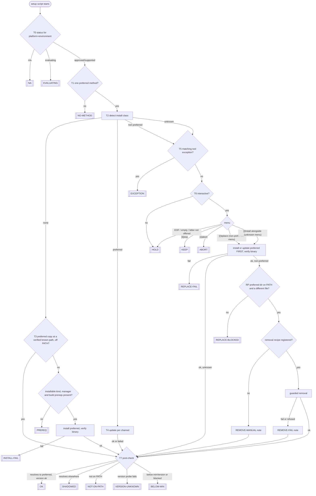

# Tool Support Decision Tree

> DRAFT -- needs commander approval (new protected reference file; intent statement
> included). Drafted by S5-Tools for Session Commander 360aa8f3-8, 2026-10-20;
> revision 2 after adversarial review S5-Tools-A.

**Intent**: **Purpose**: Define the one decision tree every managed-tool setup
script follows to install, update, keep, or replace a tool on the current
platform and environment, with the registry fields, library helpers, tool
exception record, and pre-commit conformance check it depends on. **Scope**:
Tree nodes and leaves, the log line and summary row for every leaf, the
install-method menu, update channels, install-method detection, the
authoritative field rules of tool registry schema 1.1, the bash/PowerShell
helper contract, the tool exception contract, the conformance check, and the
test matrix. NOT the lifecycle gates or onboarding checklist
(`@.claude/rules/tool-lifecycle.md`, `/tool-adopt`). NOT how a method is chosen
(`/tool-eval`, `@.claude/rules/tool-evaluation.md`). NOT registry data
(`/tool-registry`). NOT managed-file menus (`@.claude/rules/interactive-menus.md`).
NOT per-tool post-config such as auth or GOPATH (each setup script).
**Audience**: Agents running `/tool-adopt`, agents writing or migrating
`scripts/setup-*.sh/.ps1`, implementers of the `aitools-lib` helpers and the
check step, reviewers of setup-script changes.

---

## 1. Terms and decisions

| Term | Meaning in this file |
|------|----------------------|
| platform | Governed term (`/glossary`); API value `$AITOOLS_PLATFORM` / `$AitoolsPlatform` = `macos`, `linux`, `windows`. On Linux the package-manager family (`apt`, `dnf`, ...) also selects methods (section 6 `family`) |
| environment | Governed term (`/glossary`); here only its API value `$AITOOLS_ENVIRONMENT` / `$AitoolsEnvironment` = `local` or `claude-code-web` |
| method | One entry of `install.<platform>[]`, identified by its `method` id (unique within the tool across all platforms) |
| preferred method | The one method with `preferred: true` selected by T1 |
| install class | Result of T2: `none`, `preferred`, `non-preferred`, `unknown` |
| tool exception | A recorded per-machine decision to keep a non-preferred or unknown install (section 8) |
| update channel | The release stream a preferred install follows (section 4) |
| interactive | `tty_interactive` / `Test-InteractiveConsole` is true AND `AITOOLS_FORCE` is not `1` AND `AITOOLS_DRY_RUN` is not `1` |

"Install class" is used instead of "provenance" (a governed term for an aitools
component). The existing helpers `detect_go_provenance` / `Get-GoProvenance`
predate this file and are replaced by `tool_detect_method` / `Get-ToolInstallMethod`.

| Id | Decision | Recorded |
|----|----------|----------|
| D-TS1 | Preferred install method per platform and environment lives in the tool registry, protected by the sources-of-truth rule | Commander, session 360aa8f3-8, 2026-10-20 |
| D-TS2 | No preferred method: setup script ERROR + ACTION to run `/tool-eval`; `/tool-adopt` invokes `/tool-eval` interactively | same |
| D-TS3 | Found installed: preferred = update and verify; non-preferred or unknown = non-interactive/force changes nothing (WARN + ACTION), interactive = replace (install first, verify it resolves, then remove) / keep / abort; unknown never auto-removed | same |
| D-TS4 | `[k]eep` remembered per machine in `profiles.<alias>.toolExceptions` (schema owned by mission M3) | same |
| D-TS5 | Per-tool `updateChannel`, default `latest-stable` | same |
| D-TS6 | Skill named `/tool-adopt`; glossary disambiguates it from managed-file adopt | same |
| D-TS7 | `/tool-eval` and `/tool-adopt` read and maintain the registry and `tool-lifecycle.md` | same |
| D-TS8 | Extend the tool-lifecycle framework; new reference file for the tree | same |
| D-TS9 | Every touched artifact carries an intent header | same |
| D-TS10 (proposed, Q2) | A recorded tool exception reports OK, not WARN: the user decided it, so it is not a caveat. This deliberately departs from F3 for recorded exceptions only | pending commander |
| D-TS11 (proposed, Q10) | SHADOWED is ERROR although another copy runs: "supported" means the command resolves to the managed copy (`plans/tooling-resolution-and-artifact-registry.md` decision 10); needs a severity-guide line in `reference/script-standards-detail.md` | pending commander |
| D-TS12 (proposed, Q11) | A platform still `evaluating` reports WARN `under evaluation` + ACTION, not ERROR | pending commander |
| F1-F4 | Install first, clean up second / judge success by the binary / a working tool kept as-is is WARN / go.dev tarball at `/usr/local/go` is upstream | `plans/linux-install-hardening.md` "Foundational decisions" |

## 2. The tree



Dry run (`AITOOLS_DRY_RUN=1`) is an overlay, not a branch: the tree runs every
read-only node, never prompts (T6 is "no"), replaces each acting node (I, T4,
R1, R3, exception write) with a `[DRY RUN] would <verb>` log line, and reports
the leaf it would reach with detail `dry-run: <leaf>` in that leaf's category.

### Node rules

| Node | Rule | Source |
|------|------|--------|
| T0 | Status = `lifecycle.environments.<environment>.status` (non-`local` environments only) when present, else `lifecycle.platformStatus.<platform>`. `n/a` → NA; `evaluating` → EVALUATING | D-CHR1; D-TS12 |
| T1 | Candidates = `install.<platform>[]` entries with `preferred: true` whose `family` (Linux) matches the detected family or is absent, and whose `environments` contains the current environment or is absent. The most specific match wins (explicit `environments` beats absent; explicit `family` beats absent). Zero, or two equally specific, = NO-METHOD (and check 1 fails) | D-TS1, D-TS2 |
| T2 | Resolve the command (`hash -r` + `command -v` / `Refresh-Path` + `Get-Command -CommandType Application`). Probe order: the preferred method first; then every method whose detection uses a package-database probe (`brew-*`, `dpkg`, `winget`, `choco`, `scoop`, `pkgutil`, `uv-tool`, `cargo-crate`, `npm-global`); then path-only methods; registry order within each group. First match wins; no match = `unknown` | D-TS3; review D-04 |
| T3 | Only `knownPaths` entries recorded as verified (section 6) count. A hit = installed the preferred way but off PATH: do not reinstall; T7 reports NOT-ON-PATH | Standard 4 |
| P | `kind` `system` / `bundled` are not installable: absent → PREREQ `not provided by <platform or environment>`. Otherwise the method's manager is on PATH and `check_build_prereqs` / `Check-BuildPrereqs` passes for source builds. No fallback to another method (Q4) | script-standards "Build prerequisite validation" |
| I | Success judged by the binary the method installs, matched by its detection probe, not by output text | F2 |
| T4 | Section 4. A failed update only logs a warning and continues to T7; T7's row is then promoted to WARN by `write_summary`, or reports the broken state if the tool no longer works | F3 |
| T5 | Section 8 match rule. A stale exception is logged (info) and ignored; continue at T6 | D-TS4 |
| T6 | Non-interactive, `--force`, and dry run change nothing. This deliberately differs from managed-file menus (force/non-interactive = overwrite) | D-TS3; `interactive-menus.md` |
| R1 | Install the preferred method, or update an existing shadowed preferred copy; verify its binary. Failure leaves the old copy untouched | D-TS3; F1; issue #12 |
| RP | Before any removal: the preferred binary's directory is on PATH (Windows: on the persistent User or Machine PATH) AND its realpath differs from the old copy's realpath. Separate reasons are logged for each sub-check. Example (nobul-mac, 2026-10-20): `node@22` is keg-only, so `opt/node@22/bin` is off PATH while `node` resolves to the `node` formula; removing that formula would leave no `node` | D-TS3 ("verify it resolves on PATH") |
| R3 | Only the registered `removal`, through `tool_remove` / `Remove-ToolMethod`, which refuses unsafe targets (section 7.3) | F1 |
| Unknown | Never removed and never offered for removal. After `[i]nstall alongside`, T7 usually reports SHADOWED naming the unknown copy; later interactive runs show the menu again until the user removes that copy or records `[k]eep` | D-TS3 |
| T7 | Resolves to a binary matched by the preferred method's detection (when tool-ops `resolution` exists for the tool, its `managedPath` is used — `plans/tooling-resolution-and-artifact-registry.md` B1); the version probe prints a version; it satisfies `versions.minVersion` and is not in `versions.blocked` | Standard 4; D-TS11 |
| Kept / held copies | EXCEPTION, KEEP and HOLD skip updates and the resolution half of T7 (the copy is not managed) but still run the version half: below `minVersion` or blocked turns the leaf into BELOW-MIN | review C-15 |

## 3. Leaves: log line, summary row, ACTION, exit

Every leaf writes exactly one summary row for the tool (`write_summary` /
`Write-Summary`). Detail text is at most 30 characters and holds no paths
(`reference/script-standards-detail.md` "Summary detail text rules"); paths go
in the log. `<ver>` is the bare version token (`1.26.1`, not the 32-character
`go version go1.26.1 darwin/arm64`). Every ACTION row pairs with a `log_warn`
carrying the same text. The installer runners add their own `script failed
(exit 1)` ERROR row for exit-1 leaves; that second row is expected and
`show_summary` keeps one row per tool (highest severity).

| Leaf | Log | Summary | ACTION | Exit |
|------|-----|---------|--------|------|
| NA | via `write_environment_skip` / `Write-EnvironmentSkip` (environment), or the platform variant `write_platform_skip` / `Write-PlatformSkip` (new, Q12) | OK `n/a (<environment>)` / `n/a (<platform>)` | -- | 0 |
| EVALUATING | `log_warn "<tool> is under evaluation on <platform>/<environment> -- not installed by aitools"` | WARN `under evaluation` | `run /tool-eval <slug> for <platform>` | 0 |
| NO-METHOD | `log_error "<tool>: no preferred install method for <platform>/<environment> in the tool registry"` | ERROR `no method for <platform>` | `run /tool-eval <slug> -- no <platform> method` | 1 |
| PREREQ | `log_error "<manager or provider> not found -- cannot install <tool> via <method>"` | ERROR `<manager> not found` / `not provided by <env>` | install instruction for the manager, or the prerequisite's setup script | 1 |
| INSTALL-FAIL | `log_error` with exit code; command output as `log_detail` | ERROR `install failed (exit N)` | remedy from `diagnose_build_failure` when it matches | 1 |
| HOLD | `log_warn "<tool> <ver> at <path> is a <method or unknown-source> install, not <preferred> -- unchanged (<non-interactive / forced / no answer>)"` | WARN `<ver> (not preferred)` / `<ver> (unknown source)` | `run aitools install in a terminal without --force to replace or keep <tool>` | 0 |
| EXCEPTION | `log "known exception: <tool> via <method> at <path>, kept <decided> (profile <alias>)"` (info) | OK `<ver> (kept)` | -- | 0 |
| KEEP | `log "tool exception recorded: <tool> via <method> at <path>"` (info) | OK `<ver> (kept)` | `commit profile.json in <userRepoPath>` once per run; on write failure or no dotprofile: `log_warn` + ACTION `run aitools user init to remember tool choices` | 0 |
| ABORT | `log_warn "<tool>: aborted by user -- unchanged"` | WARN `<ver> (aborted)` | `re-run aitools install to decide <tool>` | 2 |
| REPLACE-FAIL | `log_warn "<preferred> install failed -- kept <method> copy at <path>"` | WARN `<ver> (replace failed)` | -- | 0 |
| REPLACE-BLOCKED | `log_warn "<reason: preferred dir <pdir> not on PATH / same file as old copy> -- kept <method> copy at <path>"` | WARN `<ver> (replace blocked)` | `add <pdir> to PATH, then re-run aitools install` (PATH reason only) | 0 |
| REMOVE-MANUAL note | `log_warn "no removal recipe for <method> -- remove <path> manually"` then T7 | (T7's row) | `remove <path> -- old <tool> copy` | (T7) |
| REMOVE-FAIL note | `log_warn "<removal> failed or refused (<reason>) -- old copy at <path> remains"` then T7 | (T7's row) | `remove <path> -- old <tool> copy` | (T7) |
| OK | `log_ok "<tool> <ver> at <path> (<method>)"` | OK `<ver>` | -- | 0 |
| SHADOWED | `log_error "<cmd> resolves to <path>, not the <preferred> copy at <ppath>"` | ERROR `shadowed (see log)` | `put <pdir> before <dir> in PATH, or remove <path>` | 1 |
| NOT-ON-PATH | `log_error "<tool> installed at <ppath> but not on PATH"` | ERROR `installed but not on PATH` | `add <pdir> to PATH -- <tool> not accessible` | 1 |
| VERSION-UNKNOWN | `log_error "<path> resolves but <version probe> failed (exit N)"`; output as detail | ERROR `version check failed` | -- | 1 |
| BELOW-MIN | `log_error "<tool> <ver> is below minVersion <min>"` (or `is blocked`) | ERROR `<ver> below <min>` / `<ver> blocked` | `upgrade <tool> to <min> or later` | 1 |

Notes:
- `write_summary` promotes OK to WARN once the script has logged a warning.
  EXCEPTION and KEEP therefore log at info level; a failed update (T4) relies on
  this promotion instead of writing its own row.
- EOF at the menu is logged by `read_tty_choice` / `Read-ConsoleChoice` (warn) and ends at HOLD.
- Exit 2 means user abort (section 7.4).

## 4. Update channels

`updateChannel` in the registry; absent = `latest-stable`. Every run brings a
preferred install to its channel's latest and verifies it (T4 then T7).

| Channel | Meaning | T4 behaviour | Required fields |
|---------|---------|--------------|-----------------|
| `latest-stable` | Newest stable release (default) | Update built from `kind` + `package` (section 7.2); distinguish "already up to date" from failure (Standard 3) | -- |
| `lts` | The vendor's current long-term-support line | Update within the LTS package. Moving to a new line is a `/tool-eval` registry change that keeps the old line as a `preferred: false` method with detection and removal (check 10) | `reason` |
| `pinned-major` | Stay on one major version | Update within the pin; installed major other than `pin` = HOLD-style WARN `<ver> (pin <pin>)` + ACTION `run /tool-eval <slug> -- pin <pin>` | `pin`, `reason` |
| `pinned-minor` | Stay on one minor line, take patches | As pinned-major at minor granularity (python `3.14` via `uv python install 3.14 --default --upgrade`) | `pin`, `reason` |
| `vendor-auto` | The vendor updates it outside aitools (apt cron for Chrome; image-provided runtimes) | No update; verify only | `reason` |

A preferred method with an installable `kind`, or `kind: custom` with a
script-defined `tool_custom_update` / `Invoke-ToolCustomUpdate`, has an update
path; `system` and `bundled` kinds require `autoUpdates: true` or channel
`vendor-auto`. Verification does not query upstream for the newest version
number (Q6); the update command is the mechanism.

## 5. Install-method detection

Each method carries `detection`: one probe string, or an array whose probes
must all pass. Probes are typed and read-only; the library implements each
kind; the registry never holds shell code that the library executes.

| Probe | Passes when | bash | PowerShell |
|-------|-------------|------|------------|
| `path:<glob>` | the resolved binary's realpath matches the glob | perl `Cwd::abs_path` (macOS `/bin/bash` 3.2 has no `realpath` builtin) | `[IO.FileInfo]::new($p).ResolveLinkTarget($true)` (PS 7), else the path |
| `brew-formula:<name>` | `brew list --versions <name>` exits 0 AND the realpath is under `brew --prefix <name>` | yes | n/a |
| `brew-cask:<name>` | `brew list --cask <name>` exits 0 | yes | n/a |
| `dpkg:<package>` | `dpkg -S <path>` exits 0 and names `<package>` (`dpkg:*` = any) | yes | n/a |
| `winget:<id>` | `winget list --exact --id <id> --accept-source-agreements` lists the id | n/a | yes |
| `uv-tool:<name>` | `uv tool list` lists it and the binary is under `uv tool dir --bin` | yes | yes |
| `cargo-crate:<name>` | `cargo install --list` has a line starting `<name> ` | yes | yes |
| `npm-global:<pkg>` | `npm ls -g --depth=0 <pkg>` exits 0 and the binary is under `npm prefix -g` | yes | yes |
| `pkgutil:<id>` | `pkgutil --pkg-info=<id>` exits 0 | macOS | n/a |
| `choco:<pkg>` / `scoop:<app>` | package listed by `choco list --local-only` / `scoop list` | n/a | yes |

Path tokens: `{brew_prefix}`, `{brew_opt:<formula>}`, `{home}`, `{userprofile}`,
`{localappdata}`, `{programfiles}`, `{programfiles_x86}`, `{cargo_home}`,
`{gopath}`, `{uv_tool_bin}`, `{npm_prefix}`. A token that expands to an empty
value makes the probe a non-match (logged as detail).

Rules:
- Path-only probes only where no package database exists (system binaries,
  go.dev tarball, rustup, version managers). A bare `/usr/local/*` prefix is never
  a Homebrew signature.
- A probe whose manager is absent is a non-match. Probes run in conditional
  context (`if`, `||`) so `set -e` never aborts on a non-match.
- Package-database probes outrank path-only probes (T2 order), because package
  managers often wrap vendor installers at the vendor's path (Chocolatey `golang`
  and `nodejs-lts` are believed to wrap the vendor MSI — unverified; `/tool-eval`
  trials record the classification per method).

## 6. Tool registry schema 1.1 (authoritative field rules)

This section is the single authority for the fields the tree reads. The
`/tool-registry` skill points here; `meta.schemaVersion` in the registry
becomes `1.1`. Changes are additive except where marked.

| Field | Rule |
|-------|------|
| `updateChannel` | `{ "channel", "pin", "reason" }`; enum section 4; absent = `latest-stable` |
| `install.<platform>[]` (scope widened) | Every known method on the platform: preferred, alternatives, cleanup-only |
| `.method` (tightened) | Unique within the tool across all platforms (today `native` and `npm` repeat in claude-code and vercel-cli) |
| `.kind` | Required when `preferred: true`; optional (null) otherwise. Enum: `brew`, `brew-cask`, `winget`, `apt`, `dnf`, `deb-url`, `uv-tool`, `uv-python`, `cargo-git`, `npm-global`, `script-url`, `system`, `bundled`, `custom`. `system` / `bundled` are not installable. `custom` = the setup script defines the install and update functions. `script-url` requires https and a host that matches `source` |
| `.package` | Formula, winget id, apt/dnf package, uv tool, crate URL, npm package, or installer URL. With `kind` it is what the library runs |
| `.command` | Human-readable form; check 6 verifies it equals the command rendered from `kind` + `package` |
| `.family` | Linux only; `apt`, `dnf`, ... Absent = any family |
| `.environments` | Array of environment values; absent = every environment; T1 prefers explicit matches |
| `.detection` | Required on every method (section 5) |
| `.removal` | Non-preferred methods only: `brew-uninstall:<formula>`, `brew-uninstall-cask:<name>`, `npm-uninstall-global:<pkg>`, `cargo-uninstall:<crate>`, `uv-tool-uninstall:<name>`, `choco-uninstall:<pkg>`, `winget-uninstall:<id>`, `path:<dir>`; null = never removed automatically. Methods that share an install directory with the preferred method get null unless a `/tool-eval` trial proves the recipe safe |
| `.versionedPath` | true when the binary path changes with the version (nvm, volta, goenv, brew Cellar); exceptions then match by method id (section 8) |
| `.autoUpdates` | Existing; true satisfies the update-path rule (section 4) |
| `update` | Display only (shown in the registry and docs; the library builds updates from `kind` + `package`). Keys are method ids or `all` |
| `nonPreferredMethods` (deprecated) | Rows move into `install.<platform>[]` with `preferred: false`; readable in 1.1, removed in 2.0. Current values are prose or install commands and cannot drive detection |
| `knownPaths.<platform>[]` (shape changed) | `{ "path": "<tokens allowed>", "verified": "YYYY-MM-DD (vX.Y.Z)" }`; string entries are read as unverified and ignored by T3. `/tool-adopt` migrates the three existing shapes |
| `lifecycle.platformStatus` (tightened) | Enum `evaluating`, `approved`, `supported`, `n/a` |
| `lifecycle.environments.<env>.status` | Same enum; allowed only for non-`local` environments |
| `lifecycle.setupScript` | Script base name (`setup-go`), or null when an installer step owns the tool inline |

## 7. Library helpers (bash + PowerShell parity)

Helpers live in `scripts/aitools-lib.sh` / `scripts/aitools-lib.ps1`, log
through the lib's `log*` functions, capture every external command's output and
exit code (Standards 1-3), and never suppress an error without a result check.
bash code must run under macOS `/bin/bash` 3.2 (setup scripts run before
`setup-bash`, installer Steps 1-19): no associative arrays, no `mapfile`. Every
helper whose normal results include a non-zero return is called in conditional
context. Names avoid "adopt" (a governed managed-file term).

### 7.1 Tool spec input

Setup scripts read registry data from generated, committed spec files
(`generated/tool-specs/<slug>.sh` and `.ps1`, Q1), not from the JSON, because:
(1) MDM deploy scripts must be self-contained (`@.claude/rules/deploy-paths.md`);
(2) the registry cannot degrade gracefully — without it the tree has no
preferred method — and minimal Linux lacks a JSON parser (Debian `perl-base`
has no `JSON::PP`); (3) the library must not evaluate registry text. The tool
exception store (section 8) differs: it may degrade to "no exception", so it can
use a parser when one exists.

The generator (`scripts/gen-tool-specs.py`, harness python at build time) emits
an intent header, shell-quotes every value, rejects control characters, and
writes one file per tool with `lifecycle.setupScript` set. Example:

```bash
# intent: Tool spec for go generated from the tool registry -- read by
# tool_spec_load in aitools-lib.sh and embedded by build-deploy.sh. NOT editable:
# regenerate with scripts/gen-tool-specs.py. Consumers: setup-go.sh.
TOOL_SLUG='go'
TOOL_CMD='go'
TOOL_VERSION_ARGS='version'
TOOL_CHANNEL='latest-stable'
TOOL_PIN=''
TOOL_MIN_VERSION=''
# one method per line: platform|family|environments|method|preferred|kind|package|detection|removal|versionedPath
TOOL_METHODS='macos|||homebrew|1|brew|go|brew-formula:go||0
macos|||pkg-installer|0||||path:/usr/local/go/bin/go,pkgutil:org.golang.go|path:/usr/local/go|0'
TOOL_KNOWN_PATHS_macos='/opt/homebrew/bin/go'
```

The script sets its summary name (`TOOL_LABEL`) from the tool name table in
`reference/script-standards-detail.md`.

### 7.2 Functions

| bash | PowerShell | Arguments | Returns / outputs |
|------|------------|-----------|-------------------|
| `tool_spec_load` | `Import-ToolSpec` | slug | 0 loaded; 1 missing or malformed |
| `tool_status` | `Get-ToolStatus` | -- | prints `supported`, `approved`, `evaluating`, `n/a` |
| `tool_linux_family` | `--` (n/a) | -- | prints `apt`, `dnf`, ... from available managers |
| `tool_preferred_method` | `Get-ToolPreferredMethod` | -- | prints method id; 1 none; 3 ambiguous |
| `tool_detect_method` | `Get-ToolInstallMethod` | -- | bash prints `<class>|<method>|<path>`; PS1 returns `@{Class; Method; Path}`; exit 0, or 2 on internal error |
| `tool_probe` | `Test-ToolProbe` | probe, path | 0 match / 1 no match |
| `tool_known_path_hit` | `Find-ToolKnownPath` | method | prints first verified known path the method's probe accepts |
| `tool_install` | `Install-ToolMethod` | method | 0 installed and binary verified / 1 failed; builds the command from `kind` + `package`; `custom` calls `tool_custom_install` / `Invoke-ToolCustomInstall`; never removes |
| `tool_update` | `Update-ToolMethod` | method | 0 upgraded or up to date / 1 failed; `TOOL_UPDATE_STATE` / `.State` = `upgraded`, `up-to-date`, `failed`, `none`; `custom` calls `tool_custom_update` / `Invoke-ToolCustomUpdate` |
| `tool_remove` | `Remove-ToolMethod` | method, path | 0 removed / 1 failed / 2 refused (no recipe or unsafe target, 7.3) |
| `tool_version` | `Get-ToolVersion` | [binary] | prints bare version token; 1 when the probe fails |
| `tool_resolution_check` | `Test-ToolResolution` | -- | prints `ok`, `shadowed|<path>`, `missing`, `version-unknown`, `below-min|<ver>`; PS1 adds the persistent PATH test |
| `tool_interactive` | `Test-ToolInteractive` | -- | 0 when interactive (section 1) |
| `tool_method_menu` | `Read-ToolMethodChoice` | class, method, path, preferred | prints `r`, `i`, `k`, `x`, or empty |
| `tool_exception_get` | `Get-ToolException` | slug | prints `<method>|<path>|<decided>` or nothing; 1 store unreadable (warn; treated as no exception) |
| `tool_exception_record` | `Set-ToolException` | slug, method, path | 0 written / 1 failed / 3 no dotprofile or fallback profile |
| `tool_report` | `Write-ToolReport` | leaf, fields | writes the section 3 log line, summary row and ACTION |
| `tool_support_run` | `Invoke-ToolSupport` | slug, label | runs the tree; returns the section 3 exit code |

`tool_install` (or another helper named in the same batch) is also the home of
the `install_via_brew` / `install_via_apt` helpers that `cross-platform.md`
"One script per tool" names but that do not exist.

### 7.3 Removal guards (`tool_remove` / `Remove-ToolMethod`)

`path:<dir>` removal runs only when all hold; otherwise it is refused (return 2):
1. every token in `<dir>` expanded to a non-empty value;
2. the detected binary's realpath is inside `<dir>`;
3. `<dir>` is not `/`, `$HOME`, `/usr`, `/usr/local`, `/opt/homebrew`, the
   `brew --prefix`, `%USERPROFILE%`, `%ProgramFiles%`, or any token root;
4. `<dir>` is not a symlink;
5. the last segment of `<dir>` contains the tool slug or command name.

The exact command is logged at warn level before it runs. `sudo` is used only
when the directory is not owned by the user and the run is interactive.

### 7.4 Menu (identical text and order in bash and PowerShell)

Non-preferred install:

```
  <tool> <ver> at <path> was installed via <method>; the preferred method is <preferred>.
  [r]eplace : install <preferred> first, verify it, then remove the <method> copy
  [k]eep    : keep the <method> copy; remember this choice on this machine
  [x]abort  : change nothing and stop the run
  Choice [r/k/x] (default: change nothing this run):
```

Unknown source: the first line reads `... from an unknown source ...`, the first
option is `[i]nstall : install <preferred> alongside; the existing copy is not
removed`, and the prompt is `Choice [i/k/x]`. Letters are case-insensitive; a
letter not offered, empty input, or EOF = HOLD.

### 7.5 Contract with the installers and entry points

- Exit 2 from a setup script = user abort. `validate_and_run` (`aitools-install.sh`)
  and `Invoke-ValidatedScript` (`aitools-install.ps1`) write no failure row for it,
  stop the remaining steps, render the summary, and exit 2. `scripts/aitools` and
  `aitools.ps1` propagate 2 and print "aborted by user" instead of "Completed with
  errors". This also makes the managed-file `[x]abort` (`prompt_diff_review`,
  `prompt_json_field_review`) behave as documented.
- The installers pass `AITOOLS_FORCE`, `AITOOLS_DRY_RUN`, `AITOOLS_SUMMARY_FILE`.
- MDM deploy path: out of scope for the first migration batches (the installer
  skips tool setup scripts there today); embedding specs and helpers through
  `build-deploy.sh` follows mission S3-Nine's work on that file.

### 7.6 Setup script shape after migration

```bash
source "$(cd "$(dirname "${BASH_SOURCE[0]}")" && pwd)/aitools-lib.sh"
logging_init "setup-go"
# OS guard (cross-platform.md)
if ! tool_spec_load "go"; then
    log_error "tool spec for go missing -- regenerate generated/tool-specs"
    write_summary ERROR "go" "tool spec missing"
    exit 1
fi
rc=0
tool_support_run "go" "go" || rc=$?
if [ "$rc" -eq 2 ]; then exit 2; fi
if [ "$rc" -eq 0 ]; then
    : # tool-specific post-config needing a working managed tool (GOPATH/bin, auth)
fi
# exit footer (script-standards.md)
```

## 8. Tool exception contract (for mission M3)

M3 owns the profile.json / config.json schema; this is what the tree needs.

**Location**: `profiles.<alias>.toolExceptions` in the dotprofile `profile.json`
(D-TS4); `<alias>` is the profile selected by `config.json` `machineAlias`.
Distinct from top-level `overrides` (deviations from upstream tool defaults,
`reference/user-repo.md`): an exception keeps a whole install; an override
changes a setting.

```json
"toolExceptions": {
  "go": {
    "decision": "keep",
    "method": "pkg-installer",
    "path": "/usr/local/bin/go",
    "platform": "macos",
    "environment": "local",
    "decided": "2026-10-20T19:30:00Z",
    "by": "setup-go (install-method menu)",
    "note": null
  }
}
```

- One entry per tool slug; `method` is a registry method id or `unknown`;
  `decision` is `keep` only.
- `path` is the PATH-resolved command path (as `command -v` / `Get-Command`
  prints it), not the realpath, so a symlinked install survives upgrades.
- **Match**: same `platform`, same `method`, and — unless the method has
  `versionedPath: true` — the same `path` (case-insensitive on macOS and
  Windows). A non-matching entry is stale: logged "exception for <tool> no longer
  matches" and ignored.
- **Writer**: only `tool_exception_record` / `Set-ToolException`, only after
  `[k]eep`, never in dry run or non-interactive runs. Read-then-merge,
  `backup_file` / `Backup-File` first, validate after write. Refuses when the
  profile was chosen by a fallback (hostname match or first profile, not
  `machineAlias`): returns 3, warn + ACTION `run aitools user init to remember
  tool choices`.
- **Reader**: `tool_exception_get` / `Get-ToolException` at T5 every run.
- **Engine**: perl `JSON::PP` (macOS, most Linux) / `ConvertFrom-Json` (Windows),
  or whatever M3 standardises, as long as it works at installer Step 1 (no node,
  no uv python). No engine: the reader returns 1 (warn, treated as "no
  exception", the menu shows again) and the writer returns 1.
- **Carry-forward**: after a write, log the path and add ACTION `commit
  profile.json in <userRepoPath>` once per run.

## 9. Pre-commit conformance check

New step in `scripts/check-pre-commit.sh` and `.ps1` ("Tool support
conformance"), WARN while migration batches are open, FAIL once every
`lifecycle.setupScript` is migrated. Both check scripts implement it.

| # | Check | Fails when |
|---|-------|------------|
| 1 | One preferred method | a platform+environment(+family) with status approved/supported has zero preferred methods or two equally specific ones |
| 2 | Update path | a preferred method has no installable `kind`, is not `custom`, and has neither `autoUpdates: true` nor channel `vendor-auto` |
| 3 | Detection and ids | a method lacks `detection`, a probe kind is unknown, or a method id repeats within the tool |
| 4 | Channel valid | channel outside the enum, or pinned-* without `pin`/`reason` |
| 5 | Status and kind enums | status, environment status (non-local only), or `kind` outside its enum |
| 6 | Kind/package vs command | rendered command differs from `command`; `script-url` not https or host not matching `source` |
| 7 | Spec freshness | regenerated `generated/tool-specs/*` differs from the committed copy |
| 8 | Script uses the tree | a staged script named by a `lifecycle.setupScript` does not call `tool_support_run` / `Invoke-ToolSupport` |
| 9 | No ad hoc removal | a staged setup script calls `brew uninstall`, `npm uninstall`, `cargo uninstall`, `choco uninstall`, `winget uninstall`, or `rm -rf` on a path that is not a `mktemp` result, outside a line marked `# tool-support: allowed` |
| 10 | Line moves keep the old line | a registry diff changes a preferred `package` and the old package does not appear as a `preferred: false` method with `detection` |
| 11 | Summary templates | a summary detail template in `tool_report` or a staged setup script exceeds 30 characters with typical values |

The existing menu parity audit (`check-post-push` step 29) extends to
`tool_method_menu` / `Read-ToolMethodChoice` (sequence after mission S3-Nine,
which is editing check-post-push). The `/audit` skill gains: every
approved/supported tool has a setup script or an inline owner; the
`/tool-adopt` trigger directive exists in the rule.

Planned hook (framework-adoption.md step 7; build later, observe first):
PreToolUse (command) on Write/Edit of `scripts/setup-*.sh` / `.ps1`, stderr
`setup scripts follow the tool support decision tree -- use /tool-adopt
(tool-lifecycle.md)`.

## 10. Test matrix (each migrated script, isolated HOME)

Smoke test pattern (`@.claude/rules/smoke-test-pattern.md`), package-manager
stubs on PATH, both `AITOOLS_ENVIRONMENT` values where relevant.

| Case | Setup | Expected |
|------|-------|----------|
| fresh | no binary | OK, or PREREQ without the manager stub |
| preferred | binary matching preferred detection | OK; update stub exits 1 → OK row promoted to WARN |
| preferred, broken update | update stub deletes the binary | NOT-ON-PATH |
| version probe fails | binary prints nothing, exits 1 | VERSION-UNKNOWN |
| non-preferred, piped stdin | known non-preferred binary | HOLD; nothing removed |
| non-preferred, `AITOOLS_FORCE=1` in a pty | same | HOLD |
| non-preferred, pty, `r` | same | OK; stub log order install → verify → remove |
| non-preferred, pty, `r`, install fails | same | REPLACE-FAIL; old binary present |
| non-preferred, pty, `r`, preferred dir off PATH | keg-only style copy | REPLACE-BLOCKED; old binary present |
| removal guard | recipe `path:{gopath}` with GOPATH empty | REMOVE-FAIL note (refused); nothing deleted |
| non-preferred, pty, `k` | same | KEEP; second run EXCEPTION, no prompt |
| exception stale | exception for another path | menu shown again |
| exception, versioned path | nvm-style method, version dir changed | EXCEPTION |
| unknown, pty, `i` | binary matching no method, earlier on PATH | SHADOWED; unknown binary still present |
| symlinked binary | `path:` probe through a symlink | correct class |
| pty, EOF | close stdin at prompt | HOLD with EOF warning |
| pty, `x` | -- | ABORT, exit 2; installer stops; `aitools` prints "aborted by user" |
| no method | spec without a preferred method | NO-METHOD |
| evaluating | status evaluating | EVALUATING |
| n/a | status n/a | NA |
| dry run | `AITOOLS_DRY_RUN=1`, each class | the leaf it would reach, `dry-run:` detail, no writes |

## Cross-references

- Lifecycle rule and update policy: `@.claude/rules/tool-lifecycle.md`
- Framework: `@reference/framework-tool-lifecycle.md`
- Process skills: `/tool-adopt`, `/tool-eval`, `/tool-registry`
- Severity and summary rules: `@reference/script-standards-detail.md`
- Menus, console I/O, parity: `@.claude/rules/interactive-menus.md`
- Environment API: `@.claude/rules/cross-platform.md` "Environment branches"
- Profile schema: `@reference/user-repo.md`
- Resolution plan (tool-ops `resolution`, PATH ownership): `@plans/tooling-resolution-and-artifact-registry.md`
