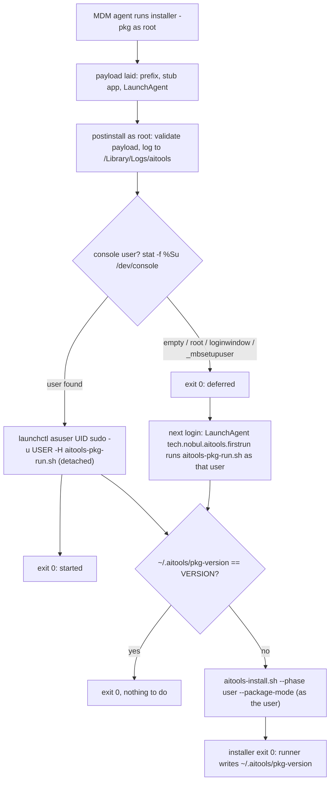
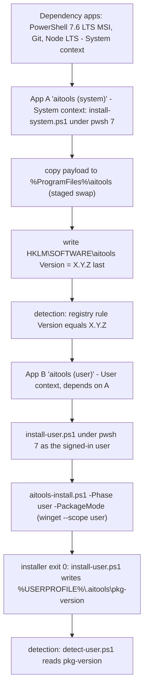
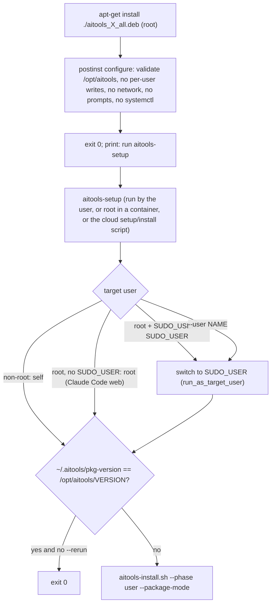

# build-package: design (version 1.0)

**Intent**: **Purpose**: Answer the commander's build-package questions with
rationale and sources: the build language, one Linux package or one per
release, the build host per package kind, how the package path coexists with
`build-deploy.sh` and the dev path, and the run context, payload, prerequisites,
personalisation, updates, detection, logging and signing of each package kind.
**Scope**: Design decisions and their reasons, per platform and environment.
NOT the batch-by-batch execution steps, interfaces and test commands
(`plans/build-package/implementation-plan.md`). NOT the fixes to existing code
that the package path needs (`plans/build-package/remediation.md`). NOT edits to
other docs (`plans/build-package/doc-edits-pending.md`). NOT a redefinition of
the dev path or the MDM path, which stay as they are. **Audience**: Jose (the
commander), deciding and approving; the mission that executes
`implementation-plan.md`, which reads this file for the why.

Author: S3-BuildPkg-PlanWriter for S3-BuildPkg, version 1.0, 2026-10-26.

Basis: the decisions file
`.aitools/channel/handoffs/2026-10-21_10cf255a-c-missions/S3-BuildPkg/S3-BuildPkg-decisions.md`
(BP-1..BP-20, cited as "BP-n"), the ten wave-1 files in the same folder (cited
by short name: RevBuild, RevInstall, RevLib, RevSetup, RevTools, PkgWin, PkgMac,
PkgLinux, Lang, DocsInv, with their section number) and
`.aitools/channel/handoffs/2026-10-21_10cf255a-c-missions/S3-MdmPkg/S3-MdmPkg-report.md`
(cited as "MDM-PKG"). Line numbers are aitools `main` at 5976553 (2026-10-26)
unless a PR is named. "Unknown" means nobody has verified it yet; the
implementation plan's test matrix (B12) is where each unknown is settled.

## 1. Context

**What is being built.** A new tool, `scripts/build-package.sh`, that produces
three kinds of installable package from the public aitools tree (brief
"Mission"):

| Package kind | File | Delivered by |
|---|---|---|
| Windows Intune Win32 app | `aitools-system-<v>.intunewin`, `aitools-user-<v>.intunewin` | Intune (two Win32 apps, the user app depends on the system app) |
| macOS flat package, unsigned | `aitools-<v>.pkg` | Intune "unmanaged PKG" and Jamf Pro policies |
| Linux package | `aitools_<v>_all.deb` | apt/dpkg on Ubuntu 24.04 and 22.04: VMs, containers, Claude Code web, Cursor cloud |

**Parallel distribution.** The package path is a third deployment path beside
the two that exist (`.claude/rules/deploy-paths.md`): the dev path (`aitools`
running `scripts/`) and the MDM path (`build-deploy.sh` generating the
dotprofile `deploy/`). Both stay working exactly as they are (commander,
2026-10-26; BP-2).

**Fleet.** The audience is a fleet of users, not only Jose's machines
(commander, 2026-10-26). A fleet user may have no dotprofile, may not know
aitools exists, and gets aitools from an endpoint-management tool or a
package. Consequence: no package may carry one person's data (BP-1, BP-11).

**Five supported platforms and environments** (commander, 2026-10-26; BP-18):

| Kind | Supported | API value (`AITOOLS_PLATFORM` / `AITOOLS_ENVIRONMENT`) |
|---|---|---|
| Platform | macOS (Apple Silicon; Intel best-effort, unsupported on the package path in v1 per P-5), Windows 11, Linux = Ubuntu 24.04 and 22.04 | `macos`, `windows`, `linux` |
| Environment | local (any platform above), Claude Code web (Ubuntu 24.04 x86_64 VM, root), Cursor cloud (Ubuntu, user very likely `ubuntu` with passwordless sudo) | `local`, `claude-code-web`, `cursor-cloud` (proposed, P-2) |

Sources: PkgLinux 5 (Claude Code web: "each session gets a fresh virtual
machine (VM) running Ubuntu 24.04 on x86_64", setup scripts "run as root";
Cursor cloud: "Cloud agents run on isolated Ubuntu machines", default user
unknown, evidence for `ubuntu` + NOPASSWD sudo), cross-platform-detail.md
"API" (value list closed at `claude-code-web | local`).

**Why packages at all.** The MDM script channels cannot carry the generated
`deploy/`: 7 of 25 generated `.ps1` files are over Intune's 200 KB script
limit and deploy-harness is over 2.2 MB (MDM-PKG 1, 3). Every channel that
fits is a package (Intune Win32 30 GB, Intune unmanaged PKG 8 GB, Jamf
packages: MDM-PKG 2).

## 2. Options considered

| Option | Shape | For | Against | Verdict |
|---|---|---|---|---|
| **A'** (MDM-PKG 5) | Package the dotprofile `deploy/` that `build-deploy.sh` generates, plus a generated installer as entry point | Offline; reuses the MDM generator | `deploy/` embeds the build-time dotprofile's identity (profile.json github/email/hostnames, CLAUDE.md template, rules) as the fallback that runs on any endpoint without a dotprofile, so a fleet would get Jose's identity (RevBuild 1f, remediation 1, critical); one package per user; library inlined 27 times per platform (RevBuild 4); `deploy/` has no standalone `aitools-lib.sh`, so the installer fails at its first `source` line (RevInstall 5) | Rejected for the fleet |
| **BP-1** (chosen) | Package the public aitools tree at a pinned git ref (`git archive`), plus `MANIFEST` and `BUILD-INFO`; launchers in `packaging/<os>/` run the existing installer from the payload | No personal data (the repo is public: MDM-PKG F7); the same scripts as the dev path, so equivalence holds by construction (BP-2); no library inlining, no 200 KB problem inside a package (RevBuild 3d, 4); triggers none of the installer's "skipping (MDM deploy)" branches (RevInstall 5); offline at install time | The dev scripts assume a git work tree (deploy-harness `add_source`, RevBuild 5) and a writable checkout (`scripts/aitools` pull/clone/build, RevInstall 4): needs a package mode (BP-6, B3, B4) | **Chosen** |
| **C'** (MDM-PKG 5) | A small MDM script carries a per-user snapshot and runs the dev path from a pinned public tag downloaded at run time | Equivalence by construction; cheap updates | Needs GitHub at run time (Intune macOS scripts: "through a proxy is not supported", MDM-PKG 2); still needs every run-context fix; redefines the MDM path in protected `deploy-paths.md`; a per-user snapshot is personal data in an MDM script | Not chosen for v1. BP-1 keeps C''s main benefit (same scripts) without the run-time download |

Why BP-1: it is the only option that is fleet-safe (no personal data), keeps
the dev and MDM paths untouched (commander "parallel"), and adds no third copy
of setup logic (deploy-paths.md I6 debt; BP-2). Its cost, a package mode in the
installer and deploy-harness, is code the dev path also benefits from (one
order list, unknown flags exit 1: RevInstall R1, R3).

## 3. Answers to the commander's questions

### (a) Language for build-package

**One bash script, `scripts/build-package.sh`** (BP-3; Lang 1).

- One function per package kind (`intune`, `pkg`, `deb`) plus `stage`, chosen
  by capability (`command -v pkgbuild`, `command -v dpkg-deb`, a resolved
  `IntuneWinAppUtil.exe`), never by `$AITOOLS_PLATFORM`
  (cross-platform.md "Dead code from platform guards"). A kind whose tool is
  absent and that was not asked for reports OK `n/a (<host>)`; a requested kind
  whose tool is absent is ERROR + ACTION, exit 1 (Lang 1).
- bash 3.2 compatible, `set -euo pipefail`, sources `aitools-lib.sh` and calls
  `logging_init "build-package"`, `--help`, exit footer (script-standards.md
  block order; Lang 3). Not the `blog` override: that is a recorded exception
  for build-deploy.sh only, and it counts no errors (Lang 3).
- Why not a `.sh` + `.ps1` pair: the `.ps1` twin could call no packaging tool
  the bash script cannot (pkgbuild and dpkg-deb do not exist on Windows;
  IntuneWinAppUtil.exe runs from Git Bash), so it would duplicate staging for no
  output difference, the same reasoning build-deploy.sh gives for itself
  (Lang 1). Why not Python/Go: no language removes the native-host requirement
  (a flat `.pkg` needs xar/Bom, a `.intunewin` needs Microsoft's tool), and a
  second logging stack is forbidden for reusable scripts (Lang 1).
- It is the second bash-only build-script exception after build-deploy.sh and
  needs two rows in protected `.claude/rules/cross-platform.md` (P-1; drafted
  in Lang 1; that file is owned by PR #99, so the rows are applied after #99
  merges, batch B13). Its reason differs from build-deploy's: the output is
  per-OS, uncommitted binary artifacts built on build hosts, never run on
  endpoints (Lang 1).

### (b) One Linux package or one per Ubuntu release

**One `.deb`, `Architecture: all`, for Ubuntu 24.04 and 22.04** (BP-9;
PkgLinux 1, 2; RevSetup Q6; RevTools Q3).

- The payload is scripts and data, no compiled code. deb-control(5): "the all
  value is meant for packages that are architecture independent. Some examples
  of this are shell and Perl scripts" (PkgLinux 1).
- Every dependency the payload needs exists in both archives with no version
  floor that matters: bash 5.1 / 5.2, perl 5.34 / 5.38, python3 3.10 / 3.12,
  git 2.34 / 2.43 (PkgLinux 2, Launchpad API). The repo targets bash 3.2, so no
  bash floor.
- `Depends: bash, perl, python3, git, curl, ca-certificates`;
  `Recommends: jq, sudo`. PowerShell is in neither archive and Ubuntu's nodejs
  is too old (12 on jammy, 18 on noble), so pwsh and node are not Depends: the
  user phase installs them through their setup scripts (BP-8; PkgLinux 2).
- Per-release builds buy nothing for a script payload. The one release-specific
  risk is a setup script that installs a distro version of a managed tool
  (pandoc today, RevTools 3 gap 4); that is fixed in the tool scripts (B7), not
  by splitting the package.
- Tested on both releases, in a root `ubuntu:24.04` container (Claude Code web
  model) and as a non-root `ubuntu` user with passwordless sudo (Cursor cloud
  model) (BP-9).

### (c) Build hosts per package kind

**Native per kind** (BP-4; Lang 2; PkgWin 1; PkgMac 1; PkgLinux 3).

| Kind | Tool | Host | Why | CI runner |
|---|---|---|---|---|
| `pkg` | `pkgbuild` + `productbuild` (in `/usr/bin`, ship with macOS; on the test host they came with the Command Line Tools path `/Library/Developer/CommandLineTools`: whether a bare macOS without CLT has them is unknown) | macOS | Apple documents no other builder; the Linux ports (bomutils, ape-pkg) are unverified and not evaluated (PkgMac 1) | `macos-14` |
| `intune` | `IntuneWinAppUtil.exe` v1.8.7 (Microsoft, proprietary licence, needs .NET Framework 4.7.2) | Windows, run from Git Bash | The only official packer; the GPL reimplementation (svrooij/ContentPrep) is a personal-account sole-maintainer project its author says is "not a replacement" (PkgWin 1) | `windows-2022` |
| `deb` | `dpkg-deb --root-owner-group --build` (part of dpkg) | Ubuntu (CI runner or container; also Claude Code web) | Canonical tool on every Ubuntu image; no third-party dependency; nFPM and fpm not adopted (PkgLinux 3; Lang 4) | `ubuntu-24.04` |
| `stage` | git, tar, perl | any host | Shared by all kinds; tested on all three runners | all three |

One CI workflow, `.github/workflows/package.yml`, with three native jobs
(BP-4, B11). No single runner has all three tools (Lang 2). Release builds run
on CI from a clean checkout at a tag: a local macOS build archives AppleDouble
`._*` entries for files that carry `com.apple.provenance` (PkgMac 1, INCIDENT
1), so the release `.pkg` must come from a runner whose checkout has no such
xattrs, and a build gate rejects any `._*` payload entry (B8).

IntuneWinAppUtil is a third-party download, so it goes through `/tool-eval`
and the tool-lifecycle Phase 2 gate before any code calls it (P-4; Lang 4;
implementation plan "Lifecycle"). pkgbuild, productbuild and dpkg-deb are
OS-provided and checked by capability; whether they get registry entries
depends on the proposed "build-host tool" lifecycle class (P-4).

### (d) Coexistence with build-deploy.sh and the dev path

- **build-package never calls build-deploy.sh** and never reads or ships the
  dotprofile `deploy/` (BP-2). The MDM path, its pre-push step 7 and its
  `deploy/` stay as they are.
- **The package path runs the dev-path scripts from the payload**: the
  launcher calls `scripts/aitools-install.sh` / `.ps1` from the payload with
  `--phase user --package-mode` (BP-6). No generated scripts, no third copy of
  setup logic. A fix to a setup script reaches packages at the next build with
  no porting step (unlike build-deploy's three duplicated templates,
  deploy-paths.md).
- **The dev path keeps working**: `--phase` defaults to `all` (today's
  behaviour) and `--package-mode` is off unless passed. The two existing order
  lists (installer Step 21 vs the sync loop: RevInstall 2.1, MDM-PKG F2)
  collapse into one data file both read, in the post-#106 sync order (BP-6).

**Equivalence statement** (for `deploy-paths.md`, drafted by DocsWriter, P-1
area): for the same git ref, platform, environment and profile, the package
path runs the same setup scripts in the same order as `aitools install`, so it
leaves the same files under `~/.aitools`, `~/.claude` and `~/.cursor` and the
same managed-tool states and summary rows, except for these differences, each
reported as a summary row and never silent:

1. `repoPath` in `~/.aitools/config.json` is the read-only payload
   (`<prefix>/repo`), not a git checkout.
2. No git pull, clone or `build-deploy.sh` run; updates come only from a new
   package version (BP-12).
3. Adopt and merge are not offered: the payload is read-only, and package runs
   are non-interactive (RevLib 7; RevSetup R8).
4. `gh auth login` is not run (no terminal; a fleet user signs in later).
5. Without a dotprofile, profile-sourced content (CLAUDE.md template values,
   user rules, settings sync) comes from the neutral fleet template or is
   reported `n/a (no dotprofile)` (BP-11); another user's profile is never
   used.

Equivalence holds by construction for the scripts themselves (same files, same
order). It does not hold today for the two items RevSetup found per run
context (root-owned files when HOME is overridden, `$SHELL` unset in
containers): those are fixed in B5 and B6 before any package ships.

## 4. Payload layout per OS

Every package carries the same staged tree, produced once by
`build-package.sh stage` (BP-1):

```
<prefix>/
  VERSION                 # "X.Y.Z" (one line); read by detection and launchers
  repo/                   # git archive <ref> of the include list (below)
    MANIFEST              # sorted list of every file in repo/ (git ls-tree of the ref, minus excludes)
    BUILD-INFO            # key=value: version, commit, ref, built (UTC Z), kind, builder
    VERSION               # same content as <prefix>/VERSION
    scripts/ shared/ reference/ registries/ .claude/rules/ .claude/skills/ [.claude/hooks/]
  bin/                    # the OS's launchers from packaging/<os>/ (not part of repo/)
```

Include list (BP-1): `scripts/`, `shared/`, `reference/`, `registries/`,
`.claude/rules/`, `.claude/skills/`, `.claude/hooks/` when present at the ref.
Excluded inside them: `*.bak.*` (two are tracked in `shared/hooks/` today,
RevSetup R24) and `.DS_Store`. Never included: `deploy/`, `tests/`, `plans/`,
`.aitools/`, `harvesting/`, any dotprofile. These are the directories the dev
scripts read at run time: deploy-harness's sources (RevBuild 5), the hooks
manifest and sources (RevSetup 3.4), `shared/skills` (RevSetup 3.8), the
CLAUDE.md template (RevSetup 3.1).

| OS | `<prefix>` | Launchers installed | Other files | Logs (system phase) |
|---|---|---|---|---|
| macOS | `/Library/Application Support/aitools/` | `bin/aitools-pkg-run.sh` (user-context runner) | `aitools.app` (stub app, bundle id `tech.nobul.aitools`, generated by `build_pkg`); `/Library/LaunchAgents/tech.nobul.aitools.firstrun.plist` | `/Library/Logs/aitools/` |
| Windows | `%ProgramFiles%\aitools\` (App A) | none in `<prefix>`: `install-system.ps1` runs from App A's content folder; `install-user.ps1` from App B's | HKLM `SOFTWARE\aitools` value `Version` | `C:\ProgramData\aitools\logs\` |
| Linux | `/opt/aitools/` | `bin/aitools-setup`; `/usr/bin/aitools-setup` symlink to it (shipped in the package data, so dpkg tracks and removes it) | none | `/var/log/aitools/` (only when `aitools-setup` runs as root for root) |

Sources: PkgMac 7 (macOS layout), PkgWin 7 (Windows two-app design), PkgLinux 7
(`/opt/aitools`; `/usr/local` is forbidden by Debian Policy for packages,
PkgLinux 4), BP-7, BP-16, BP-17.

## 5. Run context per OS

The core problem is run context, not packaging (MDM-PKG 1 line 3): every
setup script writes the process's own `$HOME` / `$env:USERPROFILE`, nothing
resolves a console user (RevLib 4, RevSetup 4.1, RevInstall 4), and as root or
SYSTEM the scripts configure the wrong account and still report OK, or leave
root-owned files in the user's home (RevSetup 0 line 2). The design rule
(BP-10): **only launchers switch user; every setup-user-\* and user-scope tool
script refuses (ERROR) to run privileged on a HOME that is not the run
user's.**

### macOS (Intune unmanaged PKG, Jamf)



- Scripts in a pkg run as root (`auth="root"` in the built PackageInfo) with a
  600 s default timeout (PkgMac 1, 2). A full tool install can exceed 10
  minutes, so the user phase runs detached (PkgMac 2).
- `launchctl asuser` "does not modify the process' credentials", so `sudo -u
  <user> -H` sets the UID and HOME (PkgMac 2, `man launchctl`).
- Homebrew runs as the owning account; brew calls run in the user phase, never
  as root (PkgMac 2, docs.brew.sh). The older claim "brew refuses root"
  (MDM-PKG F5) is superseded by the current docs (`brew as-console-user`).
- In a pkg postinstall `$3` is the target volume, not a user name (it is the
  user name only in a Jamf script object): launchers never read `$3` as a user
  (PkgMac 2, INCIDENT 2).
- The LaunchAgent also covers a second user on the same Mac and is cheap at
  every later login (version comparison, BP-13). Since macOS 13 it shows a
  background-item notification; the fleet needs a Managed Login Items profile
  with `LabelPrefix tech.nobul.aitools` (PkgMac 5).

### Windows (Intune Win32, two apps)



- Intune runs install commands under a 32-bit host; `powershell.exe` there is
  32-bit Windows PowerShell; Intune documents no pwsh 7 host (PkgWin 2). The
  harness baseline is PowerShell 7 (cross-platform.md), so App A and App B call
  `pwsh.exe` by its full literal path (`C:\Program Files\PowerShell\7\pwsh.exe`;
  `%ProgramFiles%` may expand to `Program Files (x86)` in a 32-bit host, PkgWin
  2). pwsh 7.6 LTS arrives first as a dependency app: from 7.7 there is no MSI
  (MSIX only, per-user), so a ZIP-based dependency app is planned before 7.6
  support ends (date unknown; PkgWin 2, Q2).
- **The winget CLI is not supported in the system context** (Microsoft,
  verbatim, PkgWin 2; re-verified by the orchestrator, BP-14). So App A runs
  no winget. Machine-wide tools are their own Intune apps (BP-8). App B, in
  User context, calls winget with `--scope user --exact --source winget` where
  the package supports it (BP-14).
- A User-context app assigned to users fails if it needs admin rights (PkgWin
  3), so App B never needs admin.
- Detection scripts run under Intune's Windows PowerShell host, so
  `detect-user.ps1` is written for Windows PowerShell 5.1 (it is a package
  launcher, not a harness script; see the exemption P-1). Whether a detection
  script of a User-context app runs as the user is **not documented** (PkgWin
  4): tested on a device in B12 before relying on it.

### Linux (.deb: VMs, containers, Claude Code web, Cursor cloud)



- Maintainer scripts run as root, must be idempotent, must not rely on a
  terminal, and Debian Policy discourages per-user dotfile work from packages
  (PkgLinux 4). A nested apt-get inside postinst cannot take the dpkg lock
  (RevInstall 4). So postinst lays files only (BP-7).
- Target-user rule (BP-10; PkgLinux 4): non-root = self; root + `SUDO_USER` =
  `SUDO_USER`; root without `SUDO_USER` = root; `--user` overrides; never guess
  "first UID >= 1000".
- Claude Code web: the setup script runs as root before Claude Code starts,
  must exit 0, should finish in about five minutes so the snapshot builds, and
  does not receive the environment's variables, so it sets
  `AITOOLS_ENVIRONMENT=claude-code-web` itself (PkgLinux 5;
  cross-platform-detail.md "Signals").
- Cursor cloud: the `.cursor/environment.json` `install` command runs per
  Build, must be idempotent, and sets `AITOOLS_ENVIRONMENT=cursor-cloud`
  (P-2; BP-19). Secondary signal (preview API): the socket
  `${CURSOR_AGENT_SOCKET:-/run/cursor/api.sock}` exists (PkgLinux 5).

## 6. Console-user resolution

One library API (BP-10; RevLib 4), added in batch B5. Results go to globals;
return codes 0 found, 1 none (defer), 3 error, never 2 (2 is a user abort,
D-TS13).

| Platform | Resolution order (first decisive wins) | HOME source |
|---|---|---|
| any | `AITOOLS_TARGET_USER` set: that user; not privileged: self | |
| macOS | `stat -f %Su /dev/console`; empty, `root`, `loginwindow`, `_mbsetupuser` = none (rc 1) | `dscl . -read /Users/<u> NFSHomeDirectory` |
| Linux | `SUDO_USER` when set and not `root`; else root itself | `getent passwd <u>` field 6 |
| Windows | App B already runs as the user: self. The lib only detects SYSTEM (`S-1-5-18`) and refuses user-scope work there | the process profile |

The concrete commands are proposals from platform knowledge (RevLib 4) except
the macOS console-user probes, which PkgMac 2 ran on a Mac (`stat -f %Su
/dev/console` printed the user; `scutil` `State:/Users/ConsoleUser` gave name
and UID). At the login window they are commonly `root` or `loginwindow`
(unverified; tested in B12).

## 7. Prerequisites

Prerequisites are separate MDM packages or Debian `Depends`, never installed
by the aitools package (BP-8). The launchers check them and report ERROR +
ACTION when one is missing.

| Platform | Prerequisite | How it arrives | Source |
|---|---|---|---|
| Windows | PowerShell 7.6 LTS | Intune dependency app, MSI `PowerShell-7.6.6-win-x64.msi /quiet ADD_PATH=1 ...` (ZIP app later) | PkgWin 2 |
| Windows | Git for Windows (gives Git Bash), Node.js LTS | own Intune apps from vendor MSIs, method via `/tool-eval` (not researched) | PkgWin 7, RevTools 4 |
| macOS | Command Line Tools (git) | Apple CLT `.pkg` deployed by the MDM as root (Homebrew for Mac Admins) | PkgMac 2 |
| macOS | Homebrew | its official `.pkg` (Apple Silicon only) with `/var/tmp/.homebrew_pkg_user.plist` naming the user | PkgMac 2 |
| macOS | node, pwsh (optional) | vendor `.pkg` or the user phase; node via `brew install node@22` is keg-only and fails on a fresh Mac (RevInstall 6, R6): fixed in remediation | RevTools 4, RevInstall 6 |
| macOS Intel | Homebrew `.pkg` unsupported on Intel | v1: package path unsupported on Intel unless Homebrew is preinstalled (P-5) | PkgMac Q5 |
| Linux | bash, perl, python3, git, curl, ca-certificates | `Depends:` | PkgLinux 2 |
| Linux | jq, sudo | `Recommends:` | PkgLinux 2 |
| Linux | pwsh, node, uv, go, typst, ... | the user phase's setup scripts; several have no Linux method today (RevTools 3 gap 1): B7 via `/tool-adopt` | RevTools 3 |

Linux perl modules: the dev path does not need the MDM variant's Digest::SHA /
MIME::Base64 unpacking, but whether `perl` on minimal images carries every
core module the lib and resolver use is unknown; B12 runs
`perl -MDigest::SHA -MMIME::Base64 -MFile::Path -e1` in both containers
(RevBuild 6).

## 8. Personalisation per fleet user

Never in the package (BP-1, BP-11). At run time:

- **No dotprofile (v1 default):** shared-only mode. The resolver already
  treats "no dotprofile" as rc 1, not an error (RevInstall 7). Today that mode
  gives a fleet user a CLAUDE.md with literal `{{...}}` tokens and Jose-specific
  links, all 18 harness hooks, Jose's three MCP servers and every harness skill
  (RevSetup 4.2). v1 fixes the template (a neutral fleet template, tokens
  resolved from OS identity or left with a single WARN) and reports settings
  sync as `n/a (no dotprofile)` instead of a WARN every run (B6). Fleet content
  tiers (`tier: fleet | harness` on hooks, skills and MCP servers) are proposed
  (P-3); until approved, fleet users get the full harness set, and that is a
  stated limitation.
- **A machine not in a profile:** the resolver today ends in
  `ERROR|machine profile|no machine match` plus ACTION on every run, and uses
  the profile's identity (RevLib 6). The package path needs a fleet outcome
  (rc 0, no ERROR, no identity from another person's profile): B5.
- **A user with a dotprofile:** runs `aitools user init` interactively once on
  the dev path (P-6); later package runs find it through the resolver. Never
  non-interactively: with no terminal, `user init` today creates and pushes a
  private GitHub repo by default (RevInstall 3.2, R4), which package mode must
  never trigger.
- **Clouds:** neither Claude Code web nor Cursor cloud carries `~/.claude` or
  `~/.cursor` from the user's machine (PkgLinux 5); dotprofile reachability
  there is unknown, so clouds run shared-only with a WARN, not an ERROR
  (PkgLinux Q5).

## 9. Updates (MDM-PKG Q4)

One version string for every kind = the aitools release version, passed as
`--version X.Y.Z` (BP-12). The PowerShell version stamp is a no-op today (`^`
without `(?m)` on `-Raw` content, RevInstall R12), so the installed version on
the PowerShell path is always "dev"; fixed before packages rely on it.

| Channel | Update mechanism | Source |
|---|---|---|
| Intune Win32 | new `.intunewin` per app; in-place content swap with the detection version bumped (old devices fail detection and reinstall within about 24 h for Required); supersedence only when the package shape changes (limit 10 nodes) | PkgWin 3, 7 |
| Intune macOS | pkg `--version` and stub `CFBundleShortVersionString` bumped together; "Ignore app version" = No; upload to the same app | PkgMac 3 |
| Jamf | new package + policy "Once per computer", scoped by a Smart Group on an extension attribute reading `/Library/Application Support/aitools/VERSION` | PkgMac 4, BP-12 |
| Linux VM | new `.deb` via apt; the user (or a login hook later) runs `aitools-setup` | PkgLinux 7 |
| Claude Code web, Cursor cloud | the setup/install script pins the version; changing it rebuilds the cache | PkgLinux 5 |

Package mode never self-updates from git (BP-12). Update latency: do not
promise less than about 24 h on Intune (check-in "every hour" vs "every 8
hours" on two Microsoft pages, PkgWin INCIDENT; macOS agent "usually every 8
hours", PkgMac 3).

## 10. Recurring runs and overwrite (MDM-PKG Q5)

Yes for managed files, with backups (current non-interactive behaviour, F6),
but runs happen per version, not per schedule (BP-13): Win32 reruns only on
failed detection or an update (PkgWin 3); Jamf "Once per computer" per
version; the LaunchAgent and `aitools-setup` skip when `~/.aitools/pkg-version`
equals the payload VERSION. Two existing defects make recurring runs worse and
are fixed first (B6): shell and Cursor cli-config back up on every run, so 20
no-op runs rotate useful backups away; the Cursor model is reset to Auto on
every run (RevSetup 4.3). The overwrite is documented for users.

## 11. winget scope (MDM-PKG Q6)

The winget CLI never runs in SYSTEM (BP-14; PkgWin 2). Machine-wide tools are
separate Intune apps (BP-8). In the user phase every winget call passes
`--scope user --exact --source winget` where the package supports it; the
scope per tool is decided through `/tool-eval` (`winget show --id <id>
--exact`, RevTools 4) and recorded per method in the registry (schema field
proposed, protected). Tools whose only installer is machine-scope (Go MSI,
Strawberry Perl at `C:\Strawberry`: RevTools 4 hints, unverified) become their
own Intune apps or report ERROR + ACTION in the user phase; never a silent
install into the wrong profile.

## 12. Detection rules

| Channel | Rule | Source |
|---|---|---|
| Win App A | Registry `HKLM\SOFTWARE\aitools`, value `Version`, version equals `X.Y.Z`, 32-bit = No | PkgWin 4, BP-15 |
| Win App B | Script `detect-user.ps1` (64-bit): `%USERPROFILE%\.aitools\pkg-version` equals `X.Y.Z` → write it to STDOUT, exit 0; else exit 1 with nothing on STDERR | PkgWin 4 ("exit code 0 and writes a string value to STDOUT"; any STDERR = not installed) |
| Intune macOS | Included apps: `tech.nobul.aitools` at `X.Y.Z`; success is reported when the stub is present, not when the per-user setup finished | PkgMac 3 |
| Jamf | receipt `pkgutil --pkg-info tech.nobul.aitools`; extension attribute on `/Library/Application Support/aitools/VERSION` (machine) and on the console user's `~/.aitools/pkg-version` (user setup) | PkgMac 4, BP-15 |
| Linux | `dpkg-query -W -f='${Version}' aitools`; user state: `~/.aitools/pkg-version` | PkgLinux 7 |

`~/.aitools/pkg-version` is written by the launcher (`aitools-pkg-run.sh`,
`install-user.ps1`, `aitools-setup`) after the installer's user phase exits 0
(warnings allowed). It is the per-user marker every channel reads
(implementation plan "Interfaces" 3.2).

## 13. Logging

| Phase | Location | Mechanism |
|---|---|---|
| build-package | `~/.aitools/logs/deploy.log` on the build host (v1); CI and pre-push set `AITOOLS_LOG_DIR` to a temp dir | `logging_init "build-package"` (Lang 3); own `build-package.log` later |
| macOS postinstall (root) | `/Library/Logs/aitools/` | launcher sets `AITOOLS_LOG_DIR` before sourcing the payload lib; Intune "Collect logs" accepts it (PkgMac 3) |
| Windows App A (SYSTEM) | `C:\ProgramData\aitools\logs\` | same; Intune Collect diagnostics accepts `%PROGRAMDATA%` paths (PkgWin 5) |
| Linux root-for-root | `/var/log/aitools/` | same |
| user phase (all) | `~/.aitools/logs/` (unchanged standard) | `logging.md` |

`reference/logging.md` gets one sentence for the system-phase location (BP-16;
PR #101 owns logging.md: pending draft, B13). Jamf truncates policy logs at
25 KB, so launchers print a short summary to stdout and keep detail in files
(PkgMac 4). The library's logging is not fail-safe today (an unwritable log
dir aborts under `set -e`, RevLib 5 INCIDENT 4), which matters when a launcher
relocates `AITOOLS_LOG_DIR`: fixed in B5.

## 14. Signing (later)

Unsigned in v1 (commander; BP-20). Consequences and gates:

- macOS: `pkgutil --check-signature` exits 1 on an unsigned pkg; the build gate
  expects exit 1 (PkgMac 1). Gatekeeper checks quarantined downloads; whether
  it checks an unsigned pkg an MDM agent passes to `installer` as root is
  **unknown** (PkgMac 5). The payload has no Mach-O (the stub executable is a
  shell script), so nothing needs a signature to run.
- Windows: `.intunewin` content is encrypted by the packer; Authenticode
  signing of the launchers is not required by Intune Win32 (not stated
  otherwise in PkgWin's sources).
- Linux: a GitHub release asset, no apt repository; a signed repository comes
  with a later PPA or own repo (PkgLinux 1).
- B14 (optional, after B12): Developer ID Installer signing and notarization
  for the pkg; Authenticode for the `.ps1` launchers; a signed apt repo.

## 15. MDM-PKG questions Q1-Q6: resolutions

| Q | Question (MDM-PKG 7) | Resolution | Basis |
|---|---|---|---|
| Q1 | Self-contained package (A') or bootstrap + dev path (C')? | Package (commander), built from the public tree at a pinned ref (BP-1), not from `deploy/` | brief; section 2 here |
| Q2 | Jose's machines or a fleet? | Fleet (commander) | brief |
| Q3 | Which MDM? | Intune (Windows Win32 and macOS unmanaged PKG) and Jamf (commander) | brief |
| Q4 | How do updates reach endpoints? | One release version for all kinds; per-channel mechanism in section 9 | BP-12 |
| Q5 | Should recurring runs overwrite local edits? | Yes for managed files, with backups; runs happen per version, not per schedule; backup-churn and user-field resets fixed first | BP-13; section 10 |
| Q6 | winget scope under SYSTEM? | The winget CLI never runs in SYSTEM; user phase passes `--scope user --exact --source winget`; per-tool scope through `/tool-eval` | BP-14; section 11 |

## 16. Unknowns carried into the test matrix

Each is settled in B12 (implementation plan "Test matrix" and "Risks"):
Gatekeeper on agent-installed unsigned pkgs; install-time effect of `._*`
entries; Intune macOS detection of a stub app outside `/Applications`; whether
a non-zero pkg postinstall fails the Intune or Jamf install; console user at
the login window; User-context detection-script identity on Windows; winget
machine-vs-user scope per tool; the Cursor cloud signal and default user;
whether Claude Code web can download a GitHub release asset of a repo that is
not attached; perl core modules on minimal Ubuntu images; how HOME and SHELL
are set under Jamf, Intune and `sudo -H`.
