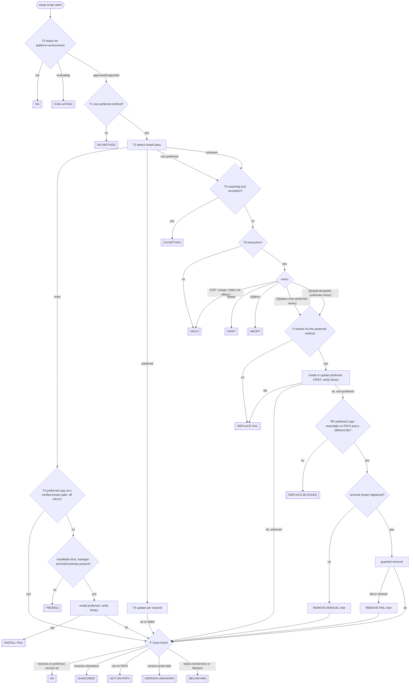

# Tool Support Decision Tree

> Revision 5, approved by the commander 2026-10-21 (item REV5,
> `plans/tool-support-and-machine-profile.md`), landed with the gate decisions that
> change it: D-TS13 reversed (no abort marker), D-TS10/11/12 decided, the exception
> engine in the native resolver (P-Q3), dotprofile writes commit and push (N-Q2),
> T-Q4, T-Q5. Section "Changes at landing" lists each one. History: drafted by
> S5-Tools 2026-10-20, revisions 2-5 by S5-Tools-A, S4-Review, S3-Gate and
> S3-GateFix (mission folders under `.aitools/channel/handoffs/`). The intent
> statement is unchanged from revision 3.

**Intent**: **Purpose**: Define the one decision tree every managed-tool setup
script follows to install, update, keep, or replace a tool on the current
platform and environment, with the registry fields, library helpers, tool
exception record, and pre-commit conformance check it depends on. **Scope**:
Tree nodes and leaves, the log line and summary row for every leaf, the
install-method menu, update channels, install-method detection, the
authoritative field rules of tool registry schema 1.1, the bash/PowerShell
helper contract, the installer and entry-point contract for exit 2, the tool
exception contract (when written, read, matched; storage shape in
`@reference/user-repo.md`), the conformance check, the `/audit` additions and
planned hook for this domain, and the test matrix. NOT the lifecycle gates or onboarding checklist
(`@.claude/rules/tool-lifecycle.md`, `/tool-adopt`). NOT how a method is chosen
(`/tool-eval`, `@.claude/rules/tool-evaluation.md`). NOT registry data
(`/tool-registry`). NOT managed-file menus (`@.claude/rules/interactive-menus.md`).
NOT per-tool post-config such as auth or GOPATH (each setup script).
**Audience**: Agents running `/tool-adopt`, agents writing or migrating
`scripts/setup-*.sh/.ps1`, implementers of the `aitools-lib` helpers and the
check step, reviewers of setup-script changes.

---

## 1. Terms and decisions

| Term | Meaning in this file |
|------|----------------------|
| platform | Governed term (`/glossary`); API value `$AITOOLS_PLATFORM` / `$AitoolsPlatform` = `macos`, `linux`, `windows`. On Linux the package-manager family (`apt`, `dnf`, ...) also selects methods (section 6 `family`) |
| environment | Governed term (`/glossary`); here only its API value `$AITOOLS_ENVIRONMENT` / `$AitoolsEnvironment` = `local` or `claude-code-web` |
| method | One entry of `install.<platform>[]`, identified by its `method` id (unique within the tool across all platforms) |
| preferred method | The one method with `preferred: true` selected by T1 |
| install class | Result of T2: `none`, `preferred`, `non-preferred`, `unknown` |
| tool exception | A recorded per-machine decision to keep a non-preferred or unknown install (section 8) |
| update channel | The release stream a preferred install follows (section 4) |
| interactive | `tty_interactive` / `Test-InteractiveConsole` is true AND `AITOOLS_FORCE` is not `1` AND `AITOOLS_DRY_RUN` is not `1` |
| runner | A loop that launches setup scripts and reads their exit codes: `validate_and_run` / `Invoke-ValidatedScript` in the installers, and `deploy_configs` / `Deploy-Configs` in the entry points `scripts/aitools` / `aitools.ps1`. Section 7.5 also binds the other launch sites (`aitools user init`, `bootstrap.sh` / `.ps1`) |

"Install class" is used instead of "provenance" (a governed term for an aitools
component). The existing helpers `detect_go_provenance` / `Get-GoProvenance`
predate this file and are replaced by `tool_detect_method` / `Get-ToolInstallMethod`.

| Id | Decision | Recorded |
|----|----------|----------|
| D-TS1 | Preferred install method per platform and environment lives in the tool registry, protected by the sources-of-truth rule | Commander, session 360aa8f3-8, 2026-10-20 |
| D-TS2 | No preferred method: setup script ERROR + ACTION to run `/tool-eval`; `/tool-adopt` invokes `/tool-eval` interactively | same |
| D-TS3 | Found installed: preferred = update and verify; non-preferred or unknown = non-interactive/force changes nothing (WARN + ACTION), interactive = replace (install first, verify it resolves, then remove) / keep / abort; unknown never auto-removed | same |
| D-TS4 | `[k]eep` remembered per machine in `profiles.<machineId>.toolExceptions` (shape in `@reference/user-repo.md`; semantics in section 8; machine profiles keyed by machine id since commander decision 5, 2026-10-22) | same |
| D-TS5 | Per-tool `updateChannel`, default `latest-stable` | same |
| D-TS6 | Skill named `/tool-adopt`; glossary disambiguates it from managed-file adopt | same |
| D-TS7 | `/tool-eval` and `/tool-adopt` read and maintain the registry and `tool-lifecycle.md` | same |
| D-TS8 | Extend the tool-lifecycle framework; new reference file for the tree | same |
| D-TS9 | Every touched artifact carries an intent header | same |
| D-TS10 | A recorded tool exception reports OK `<ver> (kept)`, not WARN: the user decided it, so it is not a caveat. This deliberately departs from F3 for recorded exceptions only | Commander, 2026-10-21 |
| D-TS11 | SHADOWED is ERROR `shadowed (see log)` + ACTION although another copy runs: "supported" means the command resolves to the managed copy (`plans/tooling-resolution-and-artifact-registry.md` decision 10); needs a severity-guide line in `reference/script-standards-detail.md` | Commander, 2026-10-21 |
| D-TS12 | A platform still `evaluating` reports WARN `under evaluation` + ACTION `run /tool-eval`, not ERROR. Summary semantics for every leaf (commander's note): a step that succeeds without errors reports OK, never downgraded to WARN by its own result; warnings and errors from the step are passed through; action required = WARN + ACTION; a failure = ERROR | Commander, 2026-10-21 |
| D-TS13 | Exit 2 from a setup script is a user abort (`[x]abort` in the tool menu or a managed-file menu). There is no abort-marker file. What each runner does on exit 2 is in section 7.5: today only an exit 2 from `deploy-harness` stops the run; any other setup script's exit 2 is an ERROR row and the run continues (commander, 2026-10-26: keep PR #106's behaviour) | Commander, 2026-10-21 (reversed from the marker design: "exit 2 = abort is fine for a user abort; avoid this") |
| T-Q4 | No automatic fallback to another install method (the modal pip and datadog cargo fallbacks are removed). A missing package manager = PREREQ: `log_error` + ERROR summary row + ACTION | Commander, 2026-10-21 |
| T-Q5 | The harness manages bash and perl: below `minVersion` it updates them; when the update fails it logs a warning, writes a WARN summary row and the run continues | Commander, 2026-10-21 |
| F1-F4 | Install first, clean up second / judge success by the binary / a working tool kept as-is is WARN / go.dev tarball at `/usr/local/go` is upstream | `plans/linux-install-hardening.md` "Foundational decisions" |

## 2. The tree



Dry run (`AITOOLS_DRY_RUN=1`) is an overlay, not a branch: the tree runs every
read-only node, never prompts (T6 is "no"), and replaces each acting node (I,
T4, R1, R3, exception write) with a `[DRY RUN] would <verb>` log line. After a
replaced acting node the tree stops: T7 is not run (it would only see the
unchanged machine), and the script reports OK `dry-run: would <verb>`
(`would install`, `would update`, `would replace`), exit 0. A path that
reaches a leaf without an acting node (NA, EVALUATING, NO-METHOD, PREREQ,
EXCEPTION, HOLD, and T7 leaves after T3) reports that leaf in its own category
with detail `dry-run: <leaf>`.

### Node rules

| Node | Rule | Source |
|------|------|--------|
| T0 | Status = `lifecycle.environments.<environment>.status` (non-`local` environments only) when present, else `lifecycle.platformStatus.<platform>`. `n/a` → NA; `evaluating` → EVALUATING | D-CHR1; D-TS12 |
| T1 | Candidates = `install.<platform>[]` entries with `preferred: true` whose `family` (Linux) matches the detected family or is absent, and whose `environments` contains the current environment or is absent. Specificity = the number of explicit dimensions (`environments`, `family`) that match; the highest wins. Zero candidates = NO-METHOD; two with equal specificity = NO-METHOD with detail `two methods for <platform>` (a registry conflict, not a missing method; check 1 fails either way) | D-TS1, D-TS2 |
| T2 | Resolve the command (`hash -r` + `command -v` / `Refresh-Path` + `Get-Command -CommandType Application`). When the tool's `resolveBy` is `knownPaths` (section 6), resolution is the first verified known path that exists instead of PATH. Probe order: the preferred method first; then every method whose detection uses a package-database probe (`brew-*`, `dpkg`, `winget`, `choco`, `scoop`, `pkgutil`, `uv-tool`, `cargo-crate`, `npm-global`); then path-only methods; registry order within each group. First match wins; no match = `unknown`. On Windows (PowerShell) the PATH searched by T2, T7 and RP is the persistent Machine PATH then User PATH, each entry environment-expanded, not the inherited process PATH: a PS1 setup script launched from Git Bash `aitools` inherits Git's `usr\bin` ahead of the managed directories, and `Refresh-Path` only adds entries, so the process PATH would give SHADOWED under one entry point and OK under the other (S3-GateFix-B GB-04; UNVERIFIED, read not run). `Get-Command` takes the first result (`Select-Object -First 1`) | D-TS3; review D-04; `@.claude/rules/cross-platform.md` "Windows: managed bash" |
| T3 | Only `knownPaths` entries recorded as verified (section 6) count. A hit = installed the preferred way but off PATH: do not reinstall; T7 reports NOT-ON-PATH | script-standards-detail "Standard 4" |
| P | `kind` `system` / `bundled` are not installable: absent → PREREQ `not provided by <platform or environment>`. Otherwise the method's manager is on PATH and `check_build_prereqs` / `Check-BuildPrereqs` passes for source builds. No fallback to another method (T-Q4). The same checks run before R1 (node RQ) and before a T4 update that builds from source: a failure there is REPLACE-FAIL `(prereq missing)` with the PREREQ ACTION (the old copy is kept), or for T4 a failed update (warn, continue to T7) | `@.claude/rules/script-standards.md` "Build prerequisite validation" |
| I | Success judged by the binary the method installs, matched by its detection probe, not by output text | F2 |
| T4 | Section 4. Source-build kinds pass the P checks first. A failed update only logs a warning and continues to T7; T7's row is then promoted to WARN by `write_summary`, or reports the broken state if the tool no longer works | F3 |
| T5 | Section 8 match rule. A stale exception is logged (info) and ignored; continue at T6 | D-TS4 |
| T6 | Non-interactive, `--force`, and dry run change nothing. This deliberately differs from managed-file menus (force/non-interactive = overwrite) | D-TS3; `interactive-menus.md` |
| R1 | Runs only after the RQ checks pass. Install the preferred method, or update an existing shadowed preferred copy; verify its binary; `tool_install` / `tool_update` print the preferred binary path (section 7.2). Failure leaves the old copy untouched | D-TS3; F1; GitHub issue #12 |
| RP | Before any removal: some directory on PATH (Windows: on the persistent User or Machine PATH, entries expanded, `<cmd>` tried with each PATHEXT extension so npm `.cmd` shims count) holds `<cmd>` that is the same file as the preferred binary path R1 reported, AND that file is not the same file as the old copy. "Same file" is file identity, not a string compare: bash `[ "$a" -ef "$b" ]`; PowerShell compares `Resolve-ToolRealPath` results case-insensitively (on case-insensitive APFS, perl `abs_path` keeps the caller's spelling, so two spellings of one file compare unequal as strings; S3-GateFix-B P2). A linked Homebrew formula passes through its `{brew_prefix}/bin` symlink; a keg-only formula whose opt `bin` is off PATH fails. Separate reasons are logged for each sub-check. Example (nobul-mac, 2026-10-20): `node@22` is keg-only, so `opt/node@22/bin` is off PATH while `node` resolves to the `node` formula; removing that formula would leave no `node` | D-TS3 ("verify it resolves on PATH") |
| R3 | Only the registered `removal`, through `tool_remove` / `Remove-ToolMethod`, which refuses unsafe targets (section 7.3) | F1 |
| Unknown | Never removed and never offered for removal. After `[i]nstall alongside`, T7 usually reports SHADOWED naming the unknown copy; later interactive runs show the menu again until the user removes that copy or records `[k]eep` | D-TS3 |
| T7 | Resolves to a binary matched by the preferred method's detection (when tool-ops `resolution` exists for the tool, its `managedPath` is used — `plans/tooling-resolution-and-artifact-registry.md` B1; when `resolveBy` is `knownPaths`, the T2 resolution rule applies and SHADOWED does not); the version probe prints a version; it satisfies `versions.minVersion` and is not in `versions.blocked` | script-standards-detail "Standard 4"; D-TS11 |
| Kept / held copies | EXCEPTION, KEEP and HOLD skip updates and the resolution half of T7 (the copy is not managed) but still run the version half: below `minVersion` or blocked turns the leaf into BELOW-MIN | review C-15 |

## 3. Leaves: log line, summary row, ACTION, exit

Every leaf writes exactly one summary row for the tool (`write_summary` /
`Write-Summary`). Detail text is at most 30 characters and holds no paths
(`reference/script-standards-detail.md` "Summary detail text rules"); paths go
in the log. `<ver>` is the bare version token (`1.26.1`, not the 32-character
`go version go1.26.1 darwin/arm64`). Every ACTION row pairs with a `log_warn`
carrying the same text. The installer runners add their own `script failed
(exit 1)` ERROR row for exit-1 leaves; that second row is expected and
`show_summary` keeps one row per tool (highest severity).

| Leaf | Log | Summary | ACTION | Exit |
|------|-----|---------|--------|------|
| NA | via `write_environment_skip` / `Write-EnvironmentSkip` (environment), or the platform variant `write_platform_skip` / `Write-PlatformSkip` (new, Q12) | OK `n/a (<environment>)` / `n/a (<platform>)` | -- | 0 |
| EVALUATING (D-TS12) | `log_warn "<tool> is under evaluation on <platform>/<environment> -- not installed by aitools"` | WARN `under evaluation` | `run /tool-eval <slug> for <platform>` | 0 |
| NO-METHOD | `log_error "<tool>: no preferred install method for <platform>/<environment> in the tool registry"` (ambiguous: `"... two equally specific preferred methods: <a>, <b>"`) | ERROR `no method for <platform>` / `two methods for <platform>` | `run /tool-eval <slug> -- no <platform> method` / `run /tool-eval <slug> -- duplicate preferred` | 1 |
| PREREQ | `log_error "<manager or provider> not found -- cannot install <tool> via <method>"` | ERROR `<manager> not found` / `not in <env> image` | install instruction for the manager, or the prerequisite's setup script | 1 |
| INSTALL-FAIL | `log_error` with exit code; command output as `log_detail` | ERROR `install failed (exit N)` | remedy from `diagnose_build_failure` when it matches | 1 |
| HOLD | `log_warn "<tool> <ver> at <path> is a <method or unknown-source> install, not <preferred> -- unchanged (<non-interactive / forced / no answer>)"` | WARN `<ver> (not preferred)` / `<ver> (unknown source)` | `run aitools install in a terminal without --force to replace or keep <tool>` | 0 |
| EXCEPTION (D-TS10) | `log "known exception: <tool> via <method> at <path>, kept <decidedAt> (profile <alias>)"` (info) | OK `<ver> (kept)` | -- | 0 |
| KEEP | `log "tool exception recorded: <tool> via <method> at <path>"` (info); the writer commits and pushes profile.json (N-Q2, section 8) | OK `<ver> (kept)`; WARN `<ver> (kept, not saved)` when the write is refused or fails; WARN `<ver> (kept, not pushed)` when the commit or push fails | refused or failed write: `log_warn` + ACTION `run aitools user init to remember tool choices`; commit or push failed: `log_warn` + ACTION `run git push in <userRepoPath>` | 0 |
| ABORT | `log_warn "<tool>: aborted by user -- unchanged"` | WARN `<ver> (aborted)` | `re-run aitools install to decide <tool>` | 2 |
| REPLACE-FAIL | `log_warn "<preferred> install failed -- kept <method> copy at <path>"`; RQ variant: `log_warn "<manager or prereq> not found -- cannot replace <method> copy at <path> with <preferred>; kept"` | WARN `<ver> (replace failed)` / `<ver> (prereq missing)` | RQ variant: the PREREQ install instruction | 0 |
| REPLACE-BLOCKED | `log_warn "<reason: preferred dir <pdir> not on PATH / same file as old copy> -- kept <method> copy at <path>"` | WARN `<ver> (replace blocked)` | `add <pdir> to PATH, then re-run aitools install` (PATH reason only) | 0 |
| REMOVE-MANUAL note | `log_warn "no removal recipe for <method> -- remove <path> manually"` then T7 | (T7's row) | `remove <path> -- old <tool> copy` | (T7) |
| REMOVE-FAIL note | `log_warn "<removal> failed or refused (<reason>) -- old copy at <path> remains"` then T7 | (T7's row) | `remove <path> -- old <tool> copy` | (T7) |
| OK | `log_ok "<tool> <ver> at <path> (<method>)"` | OK `<ver>` | -- | 0 |
| SHADOWED (D-TS11) | `log_error "<cmd> resolves to <path>, not the <preferred> copy at <ppath>"` | ERROR `shadowed (see log)` | `put <pdir> before <dir> in PATH, or remove <path>` | 1 |
| NOT-ON-PATH | `log_error "<tool> installed at <ppath> but not on PATH"` | ERROR `installed but not on PATH` | `add <pdir> to PATH -- <tool> not accessible` | 1 |
| VERSION-UNKNOWN | `log_error "<path> resolves but <version probe> failed (exit N)"`; output as detail | ERROR `version check failed` | -- | 1 |
| BELOW-MIN | `log_error "<tool> <ver> is below minVersion <min>"` (or `is blocked`). Harness runtimes bash and perl (T-Q5): the script first updates them; when the update fails it logs `log_warn` instead, and the run continues | ERROR `<ver> below <min>` / `<ver> blocked`; bash and perl: WARN `<ver> below <min>` | `upgrade <tool> to <min> or later` | 1; bash and perl: 0 |

Notes:
- `write_summary` promotes OK to WARN once the script has logged a warning.
  EXCEPTION and KEEP therefore log at info level; a failed update (T4) relies on
  this promotion instead of writing its own row.
- EOF at the menu is logged by `read_tty_choice` / `Read-ConsoleChoice` (warn) and ends at HOLD.
- Exit 2 means user abort (D-TS13, section 7.5).

## 4. Update channels

`updateChannel` in the registry; absent = `latest-stable`. Every run brings a
preferred install to its channel's latest and verifies it (T4 then T7).

| Channel | Meaning | T4 behaviour | Required fields |
|---------|---------|--------------|-----------------|
| `latest-stable` | Newest stable release (default) | Update built from `kind` + `package` (section 7.2); distinguish "already up to date" from failure (script-standards-detail "Standard 3") | -- |
| `lts` | The vendor's current long-term-support line | Update within the LTS package. Moving to a new line is a `/tool-eval` registry change that keeps the old line as a `preferred: false` method with detection and removal (check 10) | `reason` |
| `pinned-major` | Stay on one major version | Update within the pin; installed major other than `pin` = HOLD-style WARN `<ver> (pin <pin>)` + ACTION `run /tool-eval <slug> -- pin <pin>` | `pin`, `reason` |
| `pinned-minor` | Stay on one minor line, take patches | As pinned-major at minor granularity (python `3.14` via `uv python install 3.14 --default --upgrade`) | `pin`, `reason` |
| `vendor-auto` | The vendor updates it outside aitools (apt cron for Chrome; image-provided runtimes) | No update; verify only | `reason` |

A preferred method with an installable `kind`, or `kind: custom` with a
script-defined `tool_custom_update` / `Invoke-ToolCustomUpdate`, has an update
path; `system` and `bundled` kinds require `autoUpdates: true` or channel
`vendor-auto`. Verification does not query upstream for the newest version
number (Q6); the update command is the mechanism.

## 5. Install-method detection

Each method carries `detection`: one probe string, or an array whose probes
must all pass. Probes are typed and read-only; the library implements each
kind; the registry never holds shell code that the library executes.

| Probe | Passes when | bash | PowerShell |
|-------|-------------|------|------------|
| `path:<glob>` | the resolved binary's realpath matches the glob (case-insensitively on macOS and Windows) | `/bin/realpath` when present (it returns the on-disk case: probe P5, macOS), else perl `Cwd::abs_path`, which keeps the caller's spelling on case-insensitive APFS (P2) | `Resolve-ToolRealPath`: walks the path from the root and replaces every component that is a symbolic link or junction (`(Get-Item -Force <component>).LinkTarget`, PS 7.0+) until none remains; `[IO.FileInfo]::ResolveLinkTarget` alone resolves only the last component |
| `brew-formula:<name>` | `brew list --versions <name>` exits 0 AND the binary's realpath is inside the realpath of `brew --prefix <name>` (`brew --prefix` prints the `opt/<name>` symlink; its realpath is the Cellar keg) | yes | n/a |
| `brew-cask:<name>` | `brew list --cask <name>` exits 0 | yes | n/a |
| `dpkg:<package>` | `dpkg -S <path>` exits 0 and names `<package>` (`dpkg:*` = any) | yes | n/a |
| `winget:<id>` | `winget list --exact --id <id> --accept-source-agreements` lists the id | n/a | yes |
| `uv-tool:<name>` | `uv tool list` lists it and the binary is under `uv tool dir --bin` | yes | yes |
| `cargo-crate:<name>` | `cargo install --list` has a line starting `<name> ` | yes | yes |
| `npm-global:<pkg>` | `npm ls -g --depth=0 <pkg>` exits 0 and the binary is under `npm prefix -g` | yes | yes |
| `pkgutil:<id>` | `pkgutil --pkg-info=<id>` exits 0 | macOS | n/a |
| `choco:<pkg>` / `scoop:<app>` | package listed by `choco list --local-only` / `scoop list` | n/a | yes |

Path tokens: `{brew_prefix}`, `{brew_opt:<formula>}`, `{home}`, `{userprofile}`,
`{localappdata}`, `{programfiles}`, `{programfiles_x86}`, `{cargo_home}`,
`{gopath}`, `{uv_tool_bin}`, `{npm_prefix}`. A token that expands to an empty
value makes the probe a non-match (logged as detail).

Rules:
- "Inside" and "under" compare realpaths at a path-component boundary (the
  directory plus a separator), so `/usr/local/go` does not contain
  `/usr/local/gox/bin/go`. On macOS and Windows the compare is
  case-insensitive (the default volumes are case-insensitive; a
  case-sensitive APFS volume is not supported for harness paths). Lowercase
  with `perl -CSD -ne 'print lc'`, not `tr`: BSD `tr` leaves non-ASCII
  letters unchanged (P1-8: `JOSÉ` became `josÉ`), so bash and PowerShell
  would disagree.
- Path-only probes only where no package database exists (system binaries,
  go.dev tarball, rustup, version managers). A bare `/usr/local/*` prefix is never
  a Homebrew signature.
- A probe whose manager is absent is a non-match. Probes run in conditional
  context (`if`, `||`) so `set -e` never aborts on a non-match.
- Package-database probes outrank path-only probes (T2 order), because package
  managers often wrap vendor installers at the vendor's path (Chocolatey `golang`
  and `nodejs-lts` are believed to wrap the vendor MSI — unverified; `/tool-eval`
  trials record the classification per method).

## 6. Tool registry schema 1.1 (authoritative field rules)

This section is the single authority for the fields the tree reads. The
`/tool-registry` skill points here; `meta.schemaVersion` in the registry
becomes `1.1`. Changes are additive except where marked.

T-Q9 (decided 2026-10-21): the registry schema is documented in the
`/tool-registry` skill. This table moves there once that skill's move to user
level (`shared/skills/`, LAYOUT PR-b) is on main; until then it stays here, and
the skill must not restate it.

N-Q6 (decided 2026-10-21): the schema allows one preferred method per platform
(per platform, environment and Linux family where `environments` / `family`
are set). A violation is a schema error with its own detail,
`two methods for <platform>` (T1, conformance check 1), not
`no method for <platform>`.

| Field | Rule |
|-------|------|
| `updateChannel` | `{ "channel", "pin", "reason" }`; enum section 4; absent = `latest-stable` |
| `resolveBy` | `path` (default) or `knownPaths`. `knownPaths` = T2 and T7 resolve the command from the first verified `knownPaths.<platform>` entry that exists, never from PATH, and SHADOWED does not apply; for tools whose PATH name is taken by another product (Git Bash on Windows, where `bash` resolves to WSL — `@.claude/rules/cross-platform.md` "Windows: managed bash"). May be keyed per platform: `{ "windows": "knownPaths" }` |
| `install.<platform>[]` (scope widened) | Every known method on the platform: preferred, alternatives, cleanup-only |
| `.method` (tightened) | Unique within the tool across all platforms (today `native` and `npm` repeat in claude-code and vercel-cli) |
| `.kind` | Required when `preferred: true`; optional (null) otherwise. Enum: `brew`, `brew-cask`, `winget`, `apt`, `dnf`, `deb-url`, `uv-tool`, `uv-python`, `cargo-git`, `npm-global`, `script-url`, `system`, `bundled`, `custom`. `system` / `bundled` are not installable. `custom` = the setup script defines the install and update functions. `script-url` requires https and a host that matches `source` |
| `.package` | Formula, winget id, apt/dnf package, uv tool, crate URL, npm package, or installer URL. With `kind` it is what the library runs |
| `.command` | Human-readable form; check 6 verifies it equals the command rendered from `kind` + `package` |
| `.family` | Linux only; `apt`, `dnf`, ... Absent = any family |
| `.environments` | Array of environment values; absent = every environment; T1 prefers explicit matches |
| `.detection` | Required on every method (section 5) |
| `.removal` | Non-preferred methods only: `brew-uninstall:<formula>`, `brew-uninstall-cask:<name>`, `npm-uninstall-global:<pkg>`, `cargo-uninstall:<crate>`, `uv-tool-uninstall:<name>`, `choco-uninstall:<pkg>`, `winget-uninstall:<id>`, `path:<dir>`; null = never removed automatically. Methods that share an install directory with the preferred method get null unless a `/tool-eval` trial proves the recipe safe |
| `.versionedPath` | true when the binary path changes with the version (nvm, volta, goenv, brew Cellar); exceptions then match by method id (section 8) |
| `.autoUpdates` | Existing; true satisfies the update-path rule (section 4) |
| `update` | Display only (shown in the registry and docs; the library builds updates from `kind` + `package`). Keys are method ids or `all` |
| `nonPreferredMethods` (deprecated) | Rows move into `install.<platform>[]` with `preferred: false`; readable in 1.1, removed in 2.0. Current values are prose or install commands and cannot drive detection |
| `knownPaths.<platform>[]` (shape changed) | `{ "path": "<tokens allowed>", "verified": "YYYY-MM-DD (vX.Y.Z)" }`; `verified` records empirical path verification per `@.claude/rules/script-standards.md` "KnownPaths empirical verification" (not the governed deployment outcome "verified"); string entries are read as unverified and ignored by T3. `/tool-adopt` migrates the three existing shapes |
| `lifecycle.platformStatus` (tightened) | Enum `evaluating`, `approved`, `supported`, `n/a` |
| `lifecycle.environments.<env>.status` | Same enum; allowed only for non-`local` environments |
| `lifecycle.setupScript` | Script base name (`setup-go`), or null when an installer step owns the tool inline |

## 7. Library helpers (bash + PowerShell parity)

Helpers live in `scripts/aitools-lib.sh` / `scripts/aitools-lib.ps1`, log
through the lib's `log*` functions, capture every external command's output and
exit code (script-standards-detail "Standard 1"-"Standard 3"), and never suppress an error without a result check.
bash code must run under macOS `/bin/bash` 3.2 (setup scripts run before
`setup-bash`, installer Steps 1-19): no associative arrays, no `mapfile`; expand
arrays as `${a[@]+"${a[@]}"}` (an empty `"${a[@]}"` is an unbound-variable
error under `set -u` in 3.2); lowercase with perl (`perl -CSD`; `tr` only
for ASCII-only values), never `${x,,}` / `${x^^}` (bad substitution in 3.2); `printf -v` is
allowed. Every helper whose normal results include a non-zero return is called
in conditional context, and no helper except `tool_support_run` uses return
code 2 (section 7.5). bash helpers that log or count (`log_warn`, `log_error`
increment `WARNINGS` / `ERRORS`) or set globals never return their result on
stdout: a caller would have to run them in `$(...)`, a subshell that drops
every counter increment and global they set (probe: after
`p=$(tool_update ...)`, `WARNINGS=0 TOOL_UPDATE_STATE=none`; S3-GateFix-B
P1-7). They return results in globals instead, as the lib already does with
`DIFF_REVIEW_RESULT` and `JSON_FIELD_REVIEW_RESULT`: `TOOL_BIN_PATH`
(`tool_install`, `tool_update`, `tool_known_path_hit`), `TOOL_CLASS` /
`TOOL_METHOD` / `TOOL_PATH` (`tool_detect_method`), `TOOL_MENU_CHOICE`
(`tool_method_menu`), `AITLIB_TOOL_EXC_FOUND` / `AITLIB_TOOL_EXC_PLATFORM` /
`AITLIB_TOOL_EXC_METHOD` / `AITLIB_TOOL_EXC_PATH` / `AITLIB_TOOL_EXC_DECIDED_AT`
(`tool_exception_get`; the `AITLIB_` prefix is the aitools-lib result-name
contract, PR #80), `TOOL_VER`
(`tool_version`), `TOOL_RESOLUTION` (`tool_resolution_check`). Pure,
non-logging helpers (`tool_realpath`, `tool_linux_family`, `tool_status`,
`tool_preferred_method`) may print. The 3.2 rule covers every bash script the
harness runs (setup scripts, runners, entry points, bootstrap), not only
installer Steps 1-19; runners launch children with `bash` from PATH, which on
a fresh Mac is `/bin/bash` 3.2.
PowerShell helpers write nothing to the output stream except their declared
return value: native command output is captured (`$out = & <cmd> 2>&1`) and
logged, never left on the pipeline. Helper names avoid "adopt", which is
governed twice ("accept & adopt", "adoption") and names the `/tool-adopt`
process.

### 7.1 Tool spec input

The tool registry (`registries/tool-registry.json`, through the `/tool-registry`
skill) is the only source of tool specs (T-Q1, P-Q7). Setup scripts read it
through generated, committed spec files derived from it, which serve the
standalone, dev and MDM paths alike; nobody edits a spec file.

Setup scripts read registry data from generated, committed spec files
(`generated/tool-specs/<slug>.sh` and `.ps1`, Q1), not from the JSON, because:
(1) MDM deploy scripts must be self-contained (`@.claude/rules/deploy-paths.md`);
(2) the registry cannot degrade gracefully — without it the tree has no
preferred method — and minimal Linux lacks a JSON parser (Debian `perl-base`
has no `JSON::PP`); (3) the library must not evaluate registry text. The tool
exception store (section 8) differs: it may degrade to "no exception", so it can
use a parser when one exists.

The generator (`scripts/gen-tool-specs.py`, harness python) emits
an intent header, shell-quotes every value, rejects control characters, emits
only `knownPaths` entries with a non-null `verified`, and writes one file per tool
with `lifecycle.setupScript` set. Only one caller writes `generated/tool-specs/`:
the agent that makes an approved `/tool-registry` write runs the generator and
commits its output with the registry change. Pre-commit check 7 runs the
generator on every commit, into a temporary directory, and fails when the
output differs from the committed files; it never writes `generated/`.
`build-deploy.sh`, the installers and the setup scripts read the committed
files and never run the generator, so a machine without harness python (a
fresh machine before installer Step 15) can still run `aitools`. Example:

```bash
# intent: Tool spec for go generated from the tool registry -- read by
# tool_spec_load in aitools-lib.sh. NOT editable: regenerate with
# scripts/gen-tool-specs.py. Consumers: setup-go.sh (MDM embedding through
# build-deploy.sh is deferred, section 7.5).
TOOL_SLUG='go'
TOOL_CMD='go'
TOOL_VERSION_ARGS='version'
TOOL_CHANNEL='latest-stable'
TOOL_PIN=''
TOOL_MIN_VERSION=''
TOOL_RESOLVE_BY='path'
# one method per line: platform|family|environments|method|preferred|kind|package|detection|removal|versionedPath
TOOL_METHODS='macos|||homebrew|1|brew|go|brew-formula:go||0
macos|||pkg-installer|0||||path:/usr/local/go/bin/go,pkgutil:org.golang.go|path:/usr/local/go|0'
TOOL_KNOWN_PATHS_macos='/opt/homebrew/bin/go'
```

The script sets its summary name (`TOOL_LABEL`) from the tool name table in
`reference/script-standards-detail.md`.

### 7.2 Functions

"Prints" below, for the helpers that log or count (`tool_detect_method`,
`tool_known_path_hit`, `tool_install`, `tool_update`, `tool_version`,
`tool_resolution_check`, `tool_method_menu`, `tool_exception_get`), means: the
bash helper sets the global named in the section 7 introduction and prints
nothing; the PowerShell helper returns the value. Only the pure helpers
(`tool_status`, `tool_linux_family`, `tool_preferred_method`,
`tool_realpath`) print in bash.

| bash | PowerShell | Arguments | Returns / outputs |
|------|------------|-----------|-------------------|
| `tool_spec_load` | `Import-ToolSpec` | slug | 0 loaded; 1 missing or malformed. bash runs `bash -n` on the spec file before sourcing it (a syntax error in a sourced file exits the script with 2); PS1 parses it with the language parser before dot-sourcing. `Import-ToolSpec` returns `[bool]` and nothing else |
| `tool_status` | `Get-ToolStatus` | -- | prints `supported`, `approved`, `evaluating`, `n/a` |
| `tool_linux_family` | `--` (n/a) | -- | prints `apt`, `dnf`, ... from available managers |
| `tool_preferred_method` | `Get-ToolPreferredMethod` | -- | prints method id; 1 none; 3 ambiguous |
| `tool_detect_method` | `Get-ToolInstallMethod` | -- | bash prints `<class>|<method>|<path>`; PS1 returns `@{Class; Method; Path}`; exit 0, or 3 on internal error |
| `tool_probe` | `Test-ToolProbe` | probe, path | 0 match / 1 no match |
| `tool_realpath` | `Resolve-ToolRealPath` | path | prints the path with every symbolic link and junction resolved (section 5); 1 when the path does not exist |
| `tool_known_path_hit` | `Find-ToolKnownPath` | method | prints first verified known path the method's probe accepts |
| `tool_install` | `Install-ToolMethod` | method | 0 installed and binary verified / 1 failed; prints the preferred binary path (first verified known path for the method that exists; for `brew`, `{brew_prefix}/bin/<cmd>` when linked, else `{brew_opt:<formula>}/bin/<cmd>`); builds the command from `kind` + `package`; `custom` calls `tool_custom_install` / `Invoke-ToolCustomInstall`; never removes |
| `tool_update` | `Update-ToolMethod` | method | 0 upgraded or up to date / 1 failed; prints the preferred binary path as `tool_install`; `TOOL_UPDATE_STATE` / `.State` = `upgraded`, `up-to-date`, `failed`, `none`; `custom` calls `tool_custom_update` / `Invoke-ToolCustomUpdate` |
| `tool_remove` | `Remove-ToolMethod` | method, path | 0 removed / 1 failed / 4 refused (no recipe or unsafe target, 7.3) |
| `tool_version` | `Get-ToolVersion` | [binary] | prints bare version token; 1 when the probe fails |
| `tool_resolution_check` | `Test-ToolResolution` | -- | prints `ok`, `shadowed|<path>`, `missing`, `version-unknown`, `below-min|<ver>`; PS1 adds the persistent PATH test |
| `tool_interactive` | `Test-ToolInteractive` | -- | 0 when interactive (section 1) |
| `tool_method_menu` | `Read-ToolMethodChoice` | class, method, path, preferred | prints `r`, `i`, `k`, `x`, or empty |
| `tool_exception_get` | `Get-ToolException` | slug | sets `AITLIB_TOOL_EXC_FOUND` (true/false) and `AITLIB_TOOL_EXC_PLATFORM` / `_METHOD` / `_PATH` / `_DECIDED_AT`; PS1 returns `@{Found; Platform; Method; Path; DecidedAt}` or `$null`; 1 store unavailable (one warn; treated as no exception). Wraps `aitools-profile.sh` / `.ps1 exception-get` (section 8) |
| `tool_exception_record` | `Set-ToolException` | slug, method, path, version | 0 written (committed and pushed, or a commit/push warning) or nothing to write (`unchanged`, `dry-run`) / 1 failed / 3 refused: no dotprofile, or no machine profile registered to this machine (section 8 Writer). Sets `AITLIB_TOOL_EXC_RESULT` / `AITLIB_TOOL_EXC_PUSHED` (PS1 `$script:AitLibToolExcResult` / `AitLibToolExcPushed`). Wraps `aitools-profile.sh` / `.ps1 exception-set` (its exit 2 and 4 map to 1: no lib helper returns 2) |
| `tool_report` | `Write-ToolReport` | leaf, fields | writes the section 3 log line, summary row and ACTION |
| `tool_support_run` | `Invoke-ToolSupport` | slug, label | runs the tree. bash returns the section 3 exit code; PS1 sets `$script:ToolSupportRc` to it and returns nothing |

`tool_remove` returns 4, not 2, for "refused" (section 7.5: no helper uses 2).

`tool_install` (or another helper named in the same batch) is also the home of
the `install_via_brew` / `install_via_apt` helpers that `cross-platform.md`
"One script per tool" names but that do not exist.

### 7.3 Removal guards (`tool_remove` / `Remove-ToolMethod`)

`path:<dir>` removal runs only when all hold; otherwise it is refused (return 4):
1. every token in `<dir>` expanded to a non-empty value;
2. the detected binary's realpath is inside `<dir>`;
3. `<dir>` is not `/`, `$HOME`, `/usr`, `/usr/local`, `/opt/homebrew`, the
   `brew --prefix`, `%USERPROFILE%`, `%ProgramFiles%`, or any token root;
4. `<dir>` is not a symlink;
5. the last segment of `<dir>` contains the tool slug or command name.

The exact command is logged at warn level before it runs. `sudo` is used only
when the directory is not owned by the user and the run is interactive.

### 7.4 Menu (identical text and order in bash and PowerShell)

Non-preferred install:

```
  <tool> <ver> at <path> was installed via <method>; the preferred method is <preferred>.
  [r]eplace : install <preferred> first, verify it, then remove the <method> copy
  [k]eep    : keep the <method> copy; remember this choice on this machine
  [x]abort  : change nothing and stop the run
  Choice [r/k/x] (default: change nothing this run):
```

Unknown source: the first line reads `... from an unknown source ...`, the first
option is `[i]nstall : install <preferred> alongside; the existing copy is not
removed`, and the prompt is `Choice [i/k/x]`. Letters are case-insensitive; a
letter not offered, empty input, or EOF = HOLD.

Under today's runners (section 7.5) the `[x]abort` exit 2 of a tool setup
script does not stop the run: the installer writes ERROR `script failed
(exit 2)` and continues with the next step.

### 7.5 Contract with the installers and entry points

- **Exit 2 = user abort (D-TS13, reversed 2026-10-21).** A setup script exits 2
  only for `[x]abort`: the tool menu (`tool_method_menu` /
  `Read-ToolMethodChoice`, through `tool_support_run`) and the managed-file
  review menus (`prompt_diff_review` / `Prompt-DiffReview` and the JSON field
  review, `prompt_json_field_review` / `Prompt-JsonFieldReview`). There is no
  abort-marker file: the commander chose bare exit 2 over the marker design.
  Accepted risk, stated so nobody rediscovers it: bash also exits 2 on a
  `set -e` death from a command that returns 2 (`grep` and `diff` on error, a
  function's `return 2`) and on a syntax error in a sourced file (observed with
  `/bin/bash` 3.2.57, 2026-10-21); such a failure from `deploy-harness` reads
  as an abort and stops the run (from any other setup script it is an ERROR
  row either way). The guards that keep it rare: no helper returns 2 (below), scripts run
  `bash -n` before launch (`validate_and_run`), and probes that can return 2
  run in conditional context.
- **Launch sites and what each does with exit 2 today** (PR #106; the
  commander kept this behaviour 2026-10-26):
  - Installer Step 8b, `run_harness_step` (`scripts/aitools-install.sh`) /
    `Invoke-HarnessStep` (`scripts/aitools-install.ps1`), which runs
    `deploy-harness`: exit 2 = user abort. It logs `Step 8b: aborted by user
    at a review menu -- install stopped (exit 2)` (info), writes WARN
    `harness files` `aborted by user`, renders the summary and exits 2;
    Steps 9-22 do not run. The bash step runs `bash -n` first, so a syntax
    error is an ERROR row, not an abort; in PowerShell a parse error throws
    and is reported as a failure.
  - `validate_and_run` (`scripts/aitools-install.sh`: the tool setup-script
    steps and the Step 21 managed-file deploy loop) and
    `Invoke-ValidatedScript` (`scripts/aitools-install.ps1`): exit 2 is not
    distinguished. Every non-zero exit, 2 included, is `log_error "<script>
    failed (exit N)"` and ERROR `script failed (exit N)`, and the install
    continues.
  - `deploy_configs` (`scripts/aitools`, used by the no-args sync and the
    `gitpull` branch) and `Deploy-Configs` (`scripts/aitools.ps1`, same two
    branches). `deploy-harness` runs first: its exit 2 calls `deploy_abort` /
    `Invoke-DeployAbort` (info log, WARN `harness files` `aborted by user`),
    sets `deploy_aborted` / `$script:deployAborted` and leaves the loop; the
    relay mirror to `~/.cursor/AGENTS.md` is skipped. The entry point reads
    the variable (not the return value, an error count that can itself be 2),
    renders the summary and exits 2 (`gitpull` does not tag). The
    `setup-user-*` and `setup-cursor-*` scripts that follow, where most
    managed-file `[x]abort` choices happen, are not distinguished: their
    exit 2 is ERROR `script failed (exit 2)`, counted as an error, and the
    loop continues.
  - The `aitools install` branch of both entry points reads the installer's
    exit code: 2 = log `Installer aborted by user at a review menu -- run
    stopped (exit 2)`, render the summary, exit 2. The installer's only
    deliberate exit 2 is Step 8b.
  - `aitools user init` in both entry points, which launches
    `setup-user-hooks` directly: exit 2 = log `user init: aborted by user` and
    exit 2; any other non-zero = log_error and exit 1.
  - `scripts/bootstrap.sh` and `scripts/bootstrap.ps1`, which launch the
    installer and then `aitools user init` and `aitools`, do not distinguish
    exit 2: `bootstrap.sh` prints "Installer reported issues" for any non-zero
    exit and continues; `bootstrap.ps1` launches the installer with
    `powershell` (5.1) and never checks `$LASTEXITCODE`.
- The managed-file menus' `[x]abort` therefore stops the run only inside
  `deploy-harness`; in every other setup script it ends that script and the
  run continues with an ERROR row (the profile-mirror menu's "stop the run"
  text included).
- No helper uses return code 2 except `tool_support_run`, whose 2 means
  ABORT and which the script turns into `exit 2` as in
  section 7.6 (`tool_detect_method` internal error = 3, `tool_remove`
  refused = 4). A script never passes any other helper's return code through
  as its exit code.
- **Stale exit codes (PowerShell).** A PS1 child run in-process (`& $script`)
  that ends without `exit` leaves `$LASTEXITCODE` from its last native
  command, so a native command that returned 2 reads as exit 2 there, while
  the same script under `pwsh -File` exits 0. Every setup script therefore
  ends with the exit footer (an explicit `exit`), and pre-commit check 12
  enforces it.
- **PowerShell runner return values.** `Deploy-Configs` runs children
  in-process, so stray output from a child joins its return value
  (`$deployRc = Deploy-Configs ...` becomes an array). It reports its error
  count through `$script:DeployErrors` and returns nothing, like
  `Invoke-ToolSupport`.
- Outside this contract: the relay outbound prompt's `[q]` (exit 2,
  `relay-outbound-prompt.sh` / `.ps1`) runs in the entry point after the
  summary and is not a setup script; its exit 2 is the entry point's own.
- Setup scripts inherit `AITOOLS_FORCE` (exported by `scripts/aitools` /
  `aitools.ps1` for `--force`), `AITOOLS_DRY_RUN` and `AITOOLS_SUMMARY_FILE`
  (exported by the entry points, or by an installer run directly).
- MDM deploy path: out of scope for the first migration batches (the installer
  skips tool setup scripts there today); embedding specs and helpers through
  `build-deploy.sh` follows mission S3-Nine's work on that file.

### 7.6 Setup script shape after migration

bash:

```bash
source "$(cd "$(dirname "${BASH_SOURCE[0]}")" && pwd)/aitools-lib.sh"
logging_init "setup-go"
# OS guard (cross-platform.md)
if ! tool_spec_load "go"; then
    log_error "tool spec for go missing -- regenerate generated/tool-specs"
    write_summary ERROR "go" "tool spec missing"
    exit 1
fi
rc=0
tool_support_run "go" "go" || rc=$?
if [ "$rc" -eq 2 ]; then exit 2; fi
if [ "$rc" -eq 0 ]; then
    : # tool-specific post-config needing a working managed tool (GOPATH/bin, auth)
fi
# exit footer (script-standards.md)
```

PowerShell:

```powershell
. (Join-Path $PSScriptRoot "aitools-lib.ps1")
Initialize-Logging "setup-go"
# OS guard (cross-platform.md)
if (-not (Import-ToolSpec "go")) {
    LogError "tool spec for go missing -- regenerate generated/tool-specs"
    Write-Summary "ERROR" "go" "tool spec missing"
    exit 1
}
Invoke-ToolSupport -Slug "go" -Label "go"
$rc = $script:ToolSupportRc
if ($rc -eq 2) { exit 2 }
if ($rc -eq 0) {
    # tool-specific post-config needing a working managed tool (GOPATH\bin, auth)
}
# exit footer (script-standards.md)
```

`Invoke-ToolSupport` returns nothing; reading its result from the pipeline
(`$rc = Invoke-ToolSupport ...`) would also collect any stray output and
turn `$rc` into an array.

## 8. Tool exception contract

The storage shape is owned by `@reference/user-repo.md` "Profile Schema"
(`toolExceptions`); this section owns when an entry is written, read, and
matched (D-TS4). Merged by S4-Review from the M2 and M3 drafts.

**Location**: `profiles.<machineId>.toolExceptions.<slug>` in the dotprofile
`profile.json`, inside this machine's own machine profile: the one the machine
resolver (`resolve_machine_profile` / `Resolve-MachineProfile`; result in
`AITLIB_MACHINE_KEY` / `AITLIB_MACHINE_VIA` / `AITLIB_MACHINE_OWNER`, PowerShell
`$script:AitLibMachineKey` / `$script:AitLibMachineVia` /
`$script:AitLibMachineOwner`) matched with owner `this` -- not read from
`config.json` `machineId` / `machineAlias`, which are only the resolver's cached
results. A 2.1 profile keyed by alias whose `machine.id` is this machine's counts as
this machine's (it warns: migrate). Distinct from top-level `overrides`: an
exception keeps a whole install; an override changes a setting.

```json
"toolExceptions": {
  "go": {
    "decision": "keep",
    "detected": {
      "platform": "macos",
      "method": "pkg-installer",
      "path": "/usr/local/bin/go",
      "version": "1.22.5"
    },
    "decidedAt": "2026-10-20T19:30:00Z",
    "decidedBy": "setup-go",
    "reason": null
  }
}
```

- One entry per tool slug; `decision` is `keep` only; `detected.method` is a
  registry method id or `unknown` (never an install kind such as `brew`).
- `detected.path` is the PATH-resolved command path (as `command -v` /
  `Get-Command` prints it), not the realpath, so a symlinked install survives
  upgrades. `detected.version` is informational (logs) and never matched.
- **Match**: same `detected.platform` (`$AITOOLS_PLATFORM` value), same
  `detected.method`, and -- unless the method has `versionedPath: true` -- the
  same `detected.path` (case-insensitive on macOS and Windows). A non-matching
  entry is stale: logged (info) "exception for <tool> no longer matches" and
  ignored; the stale entry is replaced only by a new `[k]eep`.
- **Engine**: the native resolver (P-Q3), `scripts/aitools-profile.sh` (macOS/Linux)
  and `scripts/aitools-profile.ps1` (Windows), subcommands `exception-get --slug <s>`
  and `exception-set --slug <s> --platform <p> --method <m> --path <path>
  --version <v> --by <script> [--reason <r>]` (tagged output like `resolve`). They
  resolve the machine profile themselves. `exception-set` writes in place
  (temp -> validate -> backup -> move); both implementations keep key order and
  write the same bytes (`aitools-json.pl` / `aitools-json.ps1`), tested by
  `tests/profile/test-profile.sh`. Exit codes: 0 ok, 1 not found, 2 error,
  3 refused, 4 refused (`register` only: the alias is used by another profile, or
  `--claim` names another machine's profile).
  `exception-get` returns only this machine's decisions: an entry in a profile
  whose owner is not `this` is ignored with a warning (`found false`).
- **Reader**: `tool_exception_get` / `Get-ToolException`, called only at T5
  (install class non-preferred or unknown). It logs resolver warnings as
  `log_detail`, not `log_warn`, so a kept or preferred tool's OK row is not
  promoted to WARN by machine-profile warnings that setup-user-config already
  reports once per run. Returns 1 (no exception; one `log_warn "tool exceptions
  unavailable (<reason>)"`) when the resolver is missing or fails, or there is
  no dotprofile; the menu then shows again. `Get-ToolException` calls the
  resolver in-process (`& aitools-profile.ps1`), so its output is never decoded
  through a console code page.
- **Writer**: `tool_exception_record` / `Set-ToolException`, only after `[k]eep`,
  never in dry run or non-interactive runs (`exception-set` also writes nothing
  under `AITOOLS_DRY_RUN=1` and reports `dry-run`). `exception-set` resolves the
  machine profile itself (the same order as `resolve`, so the same result as
  `AITLIB_MACHINE_VIA` / `AITLIB_MACHINE_OWNER`) and writes only when that profile is
  this machine's (`owner` = `this`) and its via is `id`, `environment` or
  `override`. Refused (exit 3 ->
  return 3, `log_warn` + ACTION `run aitools user init to remember tool choices`)
  in every other case: `hostname`, `config` (this machine's id could not be
  detected), `alias` (the 2.1 config cache), `none`, an override naming another
  machine's or an unregistered profile, no dotprofile, or a profile read from
  `AITOOLS_PROFILE_FILE` (the read-only snapshot in generated deploy scripts).
  The resolver's `derive-config` never caches a hostname match in config.json, and
  caches `machineId` only for this machine's id-keyed profile (PR #76 review M1).
  The writer sets `AITLIB_TOOL_EXC_RESULT` (created, updated, unchanged, dry-run,
  refused, failed) and `AITLIB_TOOL_EXC_PUSHED`; unchanged and dry-run write
  nothing and do not warn.
- **Carry-forward (N-Q2)**: `exception-set` commits only `profile.json` in the
  dotprofile (other staged or modified files are left alone) and pushes it
  (`GIT_TERMINAL_PROMPT=0`, and `GIT_SSH_COMMAND="ssh -o BatchMode=yes"` unless
  the user set one, so a push never waits for credentials). On a machine without
  a git identity it commits as the profile's `identity.git`. A `profile.json`
  that already had uncommitted changes before the write is written but not
  committed (a warning asks for a manual commit; the wrapper currently also adds
  the push ACTION below, although nothing was committed -- INCIDENT, S3-M3-Docs
  approval page). A failed commit or push is a
  warning: the file is written, KEEP reports WARN `<ver> (kept, not pushed)` +
  ACTION `run git push in <userRepoPath>`; a rejected push (the remote is ahead)
  advises `git pull --rebase`, then `git push`.
- **Bootstrap**: on a fresh machine the gh step (installer Step 1) runs before
  any dotprofile exists, so there is nothing to read. The resolver needs no
  node (bash: perl; PowerShell: built in).

## 9. Pre-commit conformance check

New step in `scripts/check-pre-commit.sh` and `.ps1` ("Tool support
conformance"), WARN while migration batches are open, FAIL once every
`lifecycle.setupScript` is migrated. Both check scripts implement it.

| # | Check | Fails when |
|---|-------|------------|
| 1 | One preferred method | a platform+environment(+family) with status approved/supported has zero preferred methods or two equally specific ones |
| 2 | Update path | a preferred method has no installable `kind`, is not `custom`, and has neither `autoUpdates: true` nor channel `vendor-auto` |
| 3 | Detection and ids | a method lacks `detection`, a probe kind is unknown, a method id repeats within the tool, or `resolveBy` is `knownPaths` for a platform without a verified `knownPaths` entry |
| 4 | Channel valid | channel outside the enum, or pinned-* without `pin`/`reason` |
| 5 | Status and kind enums | status, environment status (non-local only), or `kind` outside its enum |
| 6 | Kind/package vs command | rendered command differs from `command`; `script-url` not https or host not matching `source` |
| 7 | Spec freshness | the generator's output, written to a temporary directory, differs from the committed `generated/tool-specs/*` (the check never writes `generated/`) |
| 8 | Script uses the tree | a staged script named by a `lifecycle.setupScript` does not call `tool_support_run` / `Invoke-ToolSupport` |
| 9 | No ad hoc removal | a staged setup script calls `brew uninstall`, `npm uninstall`, `cargo uninstall`, `choco uninstall`, `winget uninstall`, or `rm -rf` on a path that is not a `mktemp` result, outside a line marked `# tool-support: allowed` |
| 10 | Line moves keep the old line | a registry diff changes a preferred `package` and the old package does not appear as a `preferred: false` method with `detection` |
| 11 | Summary templates | a summary detail template in `tool_report` or a staged setup script exceeds 30 characters with typical values |
| 12 | Explicit exit | a staged setup script (`scripts/setup-*.sh/.ps1`) has no exit footer ending in an explicit `exit` (a PS1 child run in-process otherwise reports a stale `$LASTEXITCODE`, section 7.5) |

The existing menu parity audit (`check-post-push` step 29) extends to
`tool_method_menu` / `Read-ToolMethodChoice` (sequence after mission S3-Nine,
which is editing check-post-push). The `/audit` skill gains: every
approved/supported tool has a setup script or an inline owner; the
`/tool-adopt` trigger directive exists in the rule.

Planned hook (framework-adoption.md step 7; build later, observe first):
PreToolUse (command) on Write/Edit of a tool setup script (a script named by a
registry `lifecycle.setupScript`, read from `generated/tool-specs/`; never
`setup-user-*` or `setup-cursor-ide-mcp`, which are managed-file deployment), stderr
`setup scripts follow the tool support decision tree -- use /tool-adopt
(tool-lifecycle.md)`.

## 10. Test matrix (each migrated script, isolated HOME)

Smoke test pattern (`@.claude/rules/smoke-test-pattern.md`), package-manager
stubs on PATH, both `AITOOLS_ENVIRONMENT` values where relevant.

| Case | Setup | Expected |
|------|-------|----------|
| fresh | no binary | OK, or PREREQ without the manager stub |
| preferred | binary matching preferred detection | OK; update stub exits 1 → OK row promoted to WARN |
| preferred, linked Homebrew formula | binary at `{brew_prefix}/bin/<cmd>` → Cellar | class preferred (realpath compared with the realpath of `brew --prefix`) |
| preferred, broken update | update stub deletes the binary | NOT-ON-PATH |
| version probe fails | binary prints nothing, exits 1 | VERSION-UNKNOWN |
| non-preferred, piped stdin | known non-preferred binary | HOLD; nothing removed |
| non-preferred, `AITOOLS_FORCE=1` in a pty | same | HOLD |
| non-preferred, pty, `r` | same | OK; stub log order install → verify → remove |
| non-preferred, pty, `r`, install fails | same | REPLACE-FAIL; old binary present |
| non-preferred, pty, `r`, manager absent | preferred method's manager not on PATH | REPLACE-FAIL `(prereq missing)` + PREREQ ACTION; install never attempted; old binary present |
| non-preferred, pty, `r`, preferred dir off PATH | keg-only style copy | REPLACE-BLOCKED; old binary present |
| non-preferred, pty, `r`, linked formula | preferred reached through a `{brew_prefix}/bin` symlink | RP passes; removal runs |
| removal guard | recipe `path:{gopath}` with GOPATH empty | REMOVE-FAIL note (refused); nothing deleted |
| non-preferred, pty, `k` | same | KEEP; second run EXCEPTION, no prompt |
| exception stale | exception for another path | menu shown again |
| `k`, profile matched by hostname | resolver `via=hostname` | KEEP with WARN `(kept, not saved)`; nothing written; ACTION `run aitools user init ...` |
| `k`, push fails | dotprofile remote unreachable | KEEP with WARN `(kept, not pushed)`; profile.json written and committed; ACTION `run git push ...` |
| exception store unavailable | no dotprofile, non-preferred binary | one warn; menu (pty) or HOLD (piped) |
| preferred tool, profile matched by hostname | `via=hostname`, preferred binary | OK row not promoted (reader not called outside T5) |
| dry run, pty | `AITOOLS_DRY_RUN=1`, non-preferred | HOLD with `dry-run:` detail; no prompt; profile.json unchanged |
| dry run, fresh | `AITOOLS_DRY_RUN=1`, no binary | OK `dry-run: would install`, exit 0; T7 not run; nothing installed |
| exception, versioned path | nvm-style method, version dir changed | EXCEPTION |
| unknown, pty, `i` | binary matching no method, earlier on PATH | SHADOWED; unknown binary still present |
| symlinked binary | `path:` probe through a symlink | correct class |
| directory symlink or junction (PS1) | binary under a linked directory (nvm-windows style) | `Resolve-ToolRealPath` resolves it; same class as bash |
| `resolveBy: knownPaths` (Windows bash) | WSL `bash.exe` first on PATH, Git Bash at its verified known path | OK for Git Bash; no SHADOWED |
| pty, EOF | close stdin at prompt | HOLD with EOF warning |
| pty, `x` | -- | ABORT, the setup script exits 2; the installer (`validate_and_run`) writes ERROR `script failed (exit 2)` and continues |
| exit 2 from a failure (accepted risk) | a helper returns 2 outside conditional context (stub) | in `deploy-harness`: reads as an abort, the run stops (D-TS13 reversed); in any other setup script: ERROR `script failed (exit 2)`, the run continues; the guards in section 7.5 keep it rare |
| sync path, `deploy-harness` `x` | `aitools` with no arguments (and `aitools gitpull`), pty, a `deploy-harness` review answered `x` | WARN `harness files` `aborted by user`; the remaining deploy scripts and the relay mirror skipped; summary rendered; exit 2 |
| sync path, managed-file `x` | `aitools` with no arguments (and `aitools gitpull`), pty, a `setup-user-*` review answered `x` | `deploy_configs` / `Deploy-Configs` write ERROR `script failed (exit 2)` and run the remaining deploy scripts; "Completed with N error(s)", exit 1 |
| sync path, two failures | two deploy-script stubs exit 1 (`deploy_configs` returns 2) | "Completed with 2 error(s)", exit 1; not reported as an abort |
| install path, `deploy-harness` `x` | `aitools install`, Step 8b review answered `x` | WARN `harness files` `aborted by user`; Steps 9-22 not run; installer exits 2; the entry point logs "Installer aborted by user", renders the summary, exit 2 |
| install path, managed-file `x` | `aitools install`, Step 21 review answered `x` | ERROR `script failed (exit 2)`; the remaining Step 21 scripts and Step 22 run; the installer does not exit 2 |
| script run by hand, `x` | pty | menu logs the abort, exits 2 |
| `aitools user init`, hooks review `x` | pty, `setup-user-hooks` review answered `x` | "aborted by user", not "Done"; exit 2 |
| bootstrap, installer `x` | `bootstrap.sh` / `.ps1`, a review answered `x` during the install | not distinguished today: `bootstrap.sh` prints "Installer reported issues" and continues to `user init`; `bootstrap.ps1` does not check the exit code |
| entry point re-exec | deploy list changed, `aitools` re-executes itself | an abort in the re-executed run exits 2 through the outer process |
| bash helper result in a global | failed update stub, bash 3.2 | `TOOL_UPDATE_STATE=failed` and `WARNINGS` incremented in the script's shell; OK row promoted to WARN |
| RP, case spelling (macOS) | PATH spells the preferred dir in another case than the disk | RP uses `-ef`: same file, so the removal is not blocked by a spelling difference |
| Windows bash runner, pwsh child, `x` | Git Bash `aitools` sync, `deploy-harness.ps1` answered `x` | the pwsh child exits 2; bash reads it; abort reported, run stops, exit 2 (UNVERIFIED until run on Windows). A `setup-user-*.ps1` answered `x`: ERROR `script failed (exit 2)`, loop continues |
| malformed spec | spec file with an unterminated quote | `tool_spec_load` rc 1 → ERROR `tool spec missing`, exit 1 (not 2) |
| bash 3.2, empty method list | no methods for the platform, `/bin/bash` 3.2, `set -u` | NO-METHOD; no unbound-variable crash |
| no method | spec without a preferred method | NO-METHOD |
| evaluating | status evaluating | EVALUATING |
| n/a | status n/a | NA |
| dry run | `AITOOLS_DRY_RUN=1`, each class | the leaf it would reach (section 2 "Dry run"), `dry-run:` detail, no writes |

## Changes at landing (from approved revision 5)

| Decision | Change |
|----------|--------|
| D-TS13 reversed | No abort marker: section 1 term removed, D-TS13 row, section 3 ABORT row and note, section 7.2 `tool_method_menu`, section 7.5 rewritten (bare exit 2 = user abort, accepted risk stated), section 10 rows |
| D-TS10, D-TS11, D-TS12 | Decided (section 1 rows; "pending" removed in section 3); the commander's summary-semantics note added to D-TS12 |
| P-Q3 + N-Q1 | Exception engine: `aitools-profile.sh` / `.ps1` instead of `aitools-profile.js`; no node dependency (section 8, section 7.2 rows) |
| N-Q2 | `exception-set` commits and pushes profile.json; the KEEP carry-forward ACTION and its pairing exception are gone (sections 3, 8) |
| T-Q4 | No fallback methods; a missing manager is PREREQ ERROR + ACTION (section 1 row, node P) |
| T-Q5 | bash and perl below minVersion: update, and on failure WARN and continue (section 1 row, BELOW-MIN leaf) |
| T-Q1, P-Q7 | The registry is the only source of tool specs (section 7.1) |
| T-Q9, N-Q6 | Notes in section 6 |
| PR #76 review M1 (stricter than rev 5; for commander confirmation) | Section 8 Writer: `via=alias` allowed only on a machine without an id; hostname matches are never cached as `machineAlias` |
| Commander decision 5, 2026-10-22 (machine profiles keyed by machine id) and the PR #80 result-name contract | D-TS4 row, sections 7 and 7.2 (`AITLIB_` result names), section 8 Location, Engine (exit 4; only this machine's decisions), Writer (owner `this` required; `via=alias` and `via=config` now always refused, superseding the PR #76 M1 row above), Carry-forward (dirty-file and push details) |

## Cross-references

- Lifecycle rule and update policy: `@.claude/rules/tool-lifecycle.md`
- Framework: `@reference/framework-tool-lifecycle.md`
- Process skills: `/tool-adopt`, `/tool-eval`, `/tool-registry`
- Severity and summary rules: `@reference/script-standards-detail.md`
- Menus, console I/O, parity: `@.claude/rules/interactive-menus.md`
- Environment API: `@.claude/rules/cross-platform.md` "Environment branches"
- Profile schema: `@reference/user-repo.md`
- Resolution plan (tool-ops `resolution`, PATH ownership): `@plans/tooling-resolution-and-artifact-registry.md`
